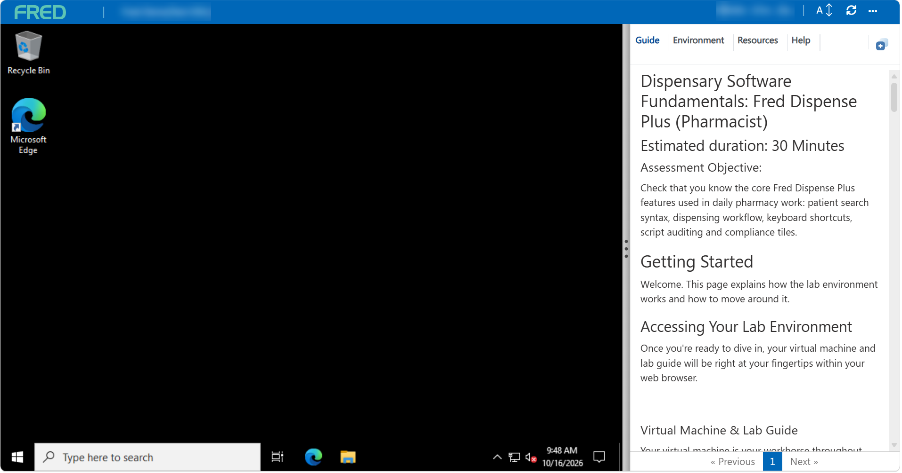
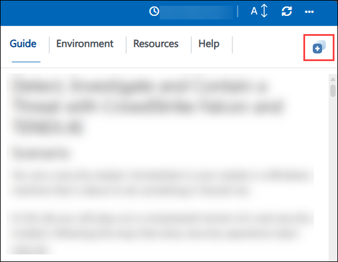
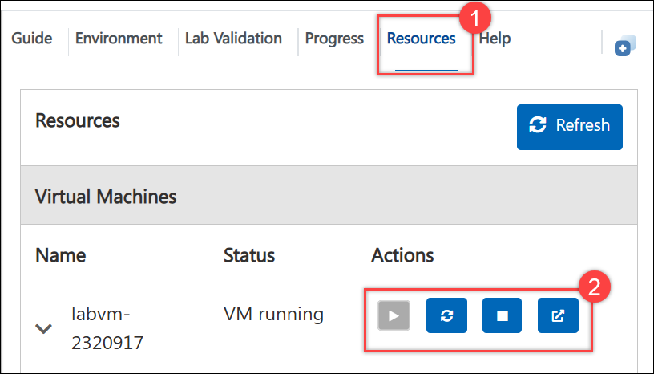

# Dispensary Software Fundamentals: Fred Dispense Plus (Pharmacist)
 
**Estimated duration:** 30 minutes
 
## Assessment Objective
 
Check that you know the core Fred Dispense Plus features used in daily pharmacy work: patient search syntax, dispensing workflow, keyboard shortcuts, script auditing and compliance tiles.
 
---
 
# Getting Started
 
Welcome. This page explains how the lab environment works and how to move around it.
 
## Accessing Your Lab Environment
 
Once you're ready to dive in, your virtual machine and lab guide will be right at your fingertips within your web browser.
 

 
### Virtual Machine & Lab Guide
 
Your virtual machine is your workhorse throughout the workshop. The lab guide is your roadmap to success.
 
## Using the Split Window Feature
 
For convenience, you can open the lab guide in a separate window by selecting the **Split Window** button in the top right corner.
 

 
## Managing Your Virtual Machine
 
Feel free to **Start, Stop, or Restart (2)** your virtual machine as needed from the **Resources (1)** tab. Your experience is in your hands!
 

 
---
 
# Assessment
 
## Instructions
 
1. Read each question carefully before choosing an answer.
2. Each question has one correct answer unless stated otherwise.
3. Select True or False, or pick the best option for multiple-choice questions.
4. You can review and change your answers before you submit.
5. The passing score is **60%**. Results are scored automatically by the in-portal panel.
## Capability Area 1: Theoretical Knowledge
 
A short quiz covering Fred Dispense Plus fundamentals. Answer all questions below.
 
### Single Choice Questions

Please answer all questions:

<question source="https://raw.githubusercontent.com/CloudLabs-Samples/EduLabs/refs/heads/main/Demo/Fred-demo/inline-questions/Question-1.md" />

<question source="https://raw.githubusercontent.com/CloudLabs-Samples/EduLabs/refs/heads/main/Demo/Fred-demo/inline-questions/Question-2.md" />

<question source="https://raw.githubusercontent.com/CloudLabs-Samples/EduLabs/refs/heads/main/Demo/Fred-demo/inline-questions/Question-3.md" />

<question source="https://raw.githubusercontent.com/CloudLabs-Samples/EduLabs/refs/heads/main/Demo/Fred-demo/inline-questions/Question-4.md" />

<question source="https://raw.githubusercontent.com/CloudLabs-Samples/EduLabs/refs/heads/main/Demo/Fred-demo/inline-questions/Question-5.md" />

<question source="https://raw.githubusercontent.com/CloudLabs-Samples/EduLabs/refs/heads/main/Demo/Fred-demo/inline-questions/Question-6.md" />

<question source="https://raw.githubusercontent.com/CloudLabs-Samples/EduLabs/refs/heads/main/Demo/Fred-demo/inline-questions/Question-7.md" />

<question source="https://raw.githubusercontent.com/CloudLabs-Samples/EduLabs/refs/heads/main/Demo/Fred-demo/inline-questions/Question-8.md" />

<question source="https://raw.githubusercontent.com/CloudLabs-Samples/EduLabs/refs/heads/main/Demo/Fred-demo/inline-questions/Question-9.md" />

<question source="https://raw.githubusercontent.com/CloudLabs-Samples/EduLabs/refs/heads/main/Demo/Fred-demo/inline-questions/Question-10.md" />

<question source="https://raw.githubusercontent.com/CloudLabs-Samples/EduLabs/refs/heads/main/Demo/Fred-demo/inline-questions/Question-11.md" />

<question source="https://raw.githubusercontent.com/CloudLabs-Samples/EduLabs/refs/heads/main/Demo/Fred-demo/inline-questions/Question-12.md" />

<question source="https://raw.githubusercontent.com/CloudLabs-Samples/EduLabs/refs/heads/main/Demo/Fred-demo/inline-questions/Question-13.md" />

## Success Criteria
- Score at least [60%] overall.
- Answer every question before submitting.
- Results are scored automatically by the in-portal panel.