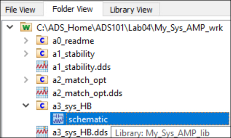
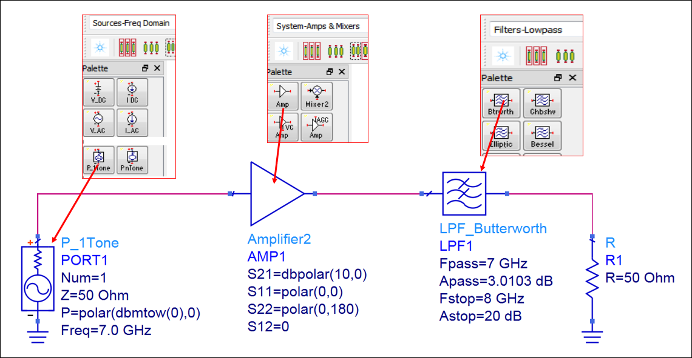
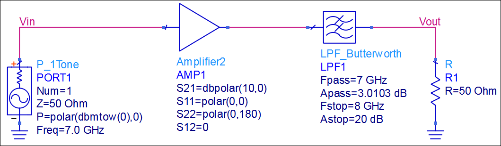

# Module 1: RF system design

**Learning Objectives:** In this module, you will complete the following tasks:

- Load workspace
- a3_Sys_HB
- Place wire label

## Task 1: Load workspace

   

1. Click **Open Workspace**

1. Select `C:\ADS_Home\ADS101\Lab04\My_Sys_AMP_wrk`

## Task 2: a3_Sys_HB

Open the schematic view of the cell **a3_Sys_HB**.

   

   

The following parameters were set for the components:

- **P_1Tone** source set **Freq= 7.0 GHz**.

- Amplifier2 set **S21=dbpolar (10,0)**.

- **LPF Butterworth** filter set **Fpass =7 GHz** and **Fstop = 8 GHz**.

These are equation based behavioural models and provide approximate responses based on the settings you make. See the ADS documentation for further information.

## Task 3: Place wire label

   

1. Name the node  between the P_1Tone source and Amplifier2 as “**Vin**".

1. Name the node between the LPF_Butterworth and the R as “**Vout**".

## You have successfully completed Module 1.

Now, click on **Next >>** from the lower right corner to move on to the next page.

   
