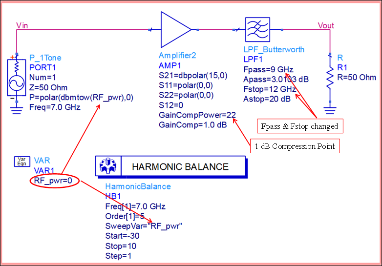
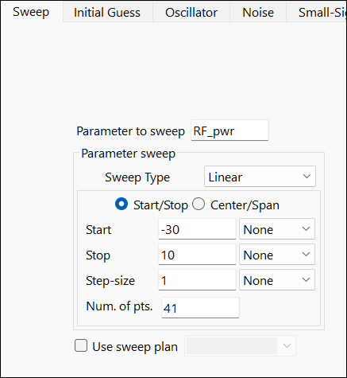
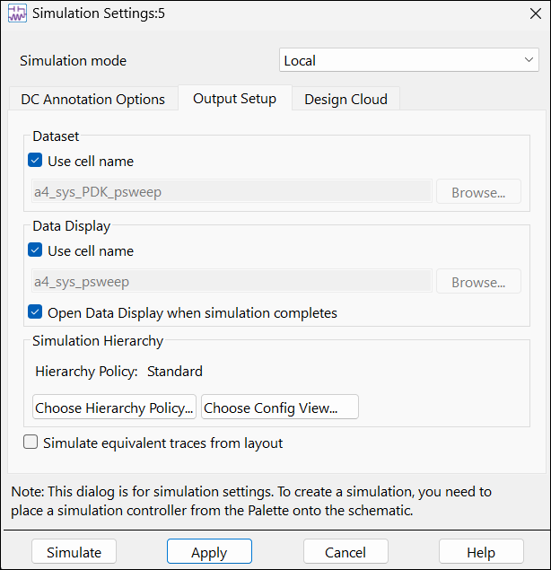

# Module 4: Variable power sweep setup

**Learning Objectives:** In this module, you will complete the following tasks:

- RF_pwr variable
- HB sweep setup
- Run the simulation

## Task 1: RF_pwr variable

Open the schematic view for cell **a4_sys_psweep**

   

There are two other changes to this schematic from the previous one.

- Amplifier2 has been assigned a 1 dB gain compression point at 22 dBm output power.

- Fpass and Fstop of the behavioral LPF model have been increased.

>**Note:** Notice that the variable **RF_pwr** was added to the schematic. This variable is used to set the power of the **P_1Tone** source. **RF_pwr** is defined in dBm, but the simulator does not understand that unit, and the function dbmtow() is used to convert dBm to Watt.

## Task 2: HB sweep setup

   

1. Double-click on the HB controller.

1. Select the **Sweep** Tab.

>**Note:** The variable **RF_pwr** will be swept from –30 dBm to 10 dBm in 1 dB steps.

## Task 3: Run the simulation

   

1. Click on **Simulate > Simulation Settings**

1. Check the flag **Use cell name**.

1. Click **Apply**

1. Click **Simulate**

## You have successfully completed Module 4.

Now, click on **Next >>** from the lower right corner to move on to the next page.

   
