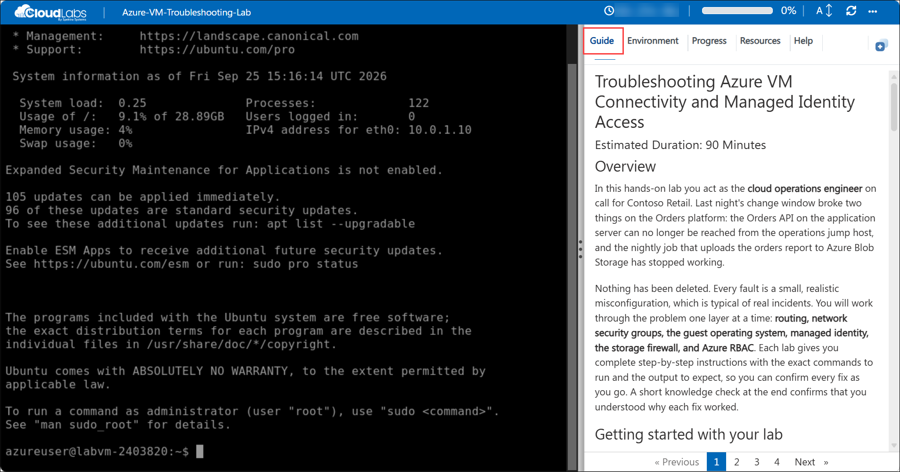
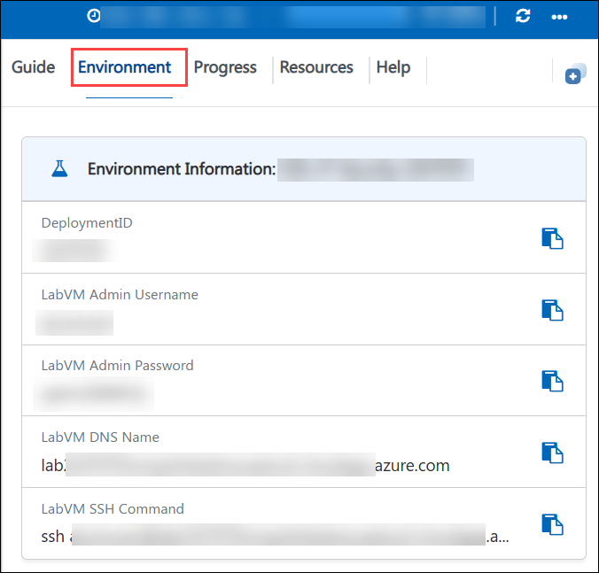
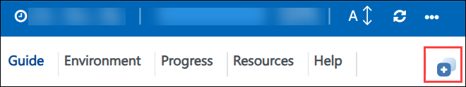

# ADS101: Advanced Design System Fundamentals

### Estimated Duration: 405 Minutes

## Overview

This hands-on lab series is made up of 6 ADS101 labs, completed in sequence:

- **Lab 01: Workspaces, Filter Design and Tuning** (90 Minutes): This lab will introduce the basic structure of ADS workspaces, libraries and cells, including basic design capture, tuning, simulation, and displaying simulation results.

- **Lab 2A: PDK, Cell Views and Comparing Data** (90 Minutes): This lab shows you how to add a reference library to the workspace – a PDK (process design kit). Afterwards, you will build another filter and create a test bench cell for simulation. You will also learn about multiple dataset manipulation.

- **Lab 2B: Filter design guide** (45 Minutes): ADS has many Design Guides that can help build and analyze designs. The filter design guide is a built-in user-interface that allows you to specify filter parameters and automatically create the designs.

- **Lab 3A: DC FET curve tracer template** (60 Minutes): This step uses a built-in DC simulation template that sweeps drain-source voltage at different steps of gate-source voltage (also called a nested sweep). The resulting IDS or bias characteristics are plotted automatically using a built-in data display template.

- **Lab 3C: Optimization and Smith Chart Utility** (60 Minutes): Perform a 50-ohm match optimization on the FET amplifier to learn how to enable component variables for optimization, set up simulation goals, and run the optimizer engine.

- **Lab 4B: Two-Tone HB and IP3 Simulation** (60 Minutes): Learn to configure two-tone sources, set up HB simulations, analyze closely spaced tones, and calculate IP3.

## Getting started with your lab

Welcome to your Keysight Advanced Design System (ADS) hands-on lab. This environment gives you a Windows 11 virtual machine with **Advanced Design System 2027** pre-installed, along with the lab workspaces you need to complete each module.

## Accessing Your Environment

Your virtual machine and this **Guide** are available within your web browser.

   

## Environment Details

1. To access the virtual machine over RDP, use the values on the **Environment** tab.

    - **VM DNS Name:** <inject key="VM DNS Name" enableCopy="true"/>
    - **Username:** <inject key="VM Username" enableCopy="true"/>
    - **Password:** <inject key="VM Password" enableCopy="true"/>

1. Your Deployment ID for this run is **<inject key="DeploymentID" enableCopy="false"/>**. Quote it if you contact support.

## Exploring Your Resources

To get a better understanding of your resources and credentials, navigate to the **Environment** tab.

   

## Utilizing the Split Window Feature

For convenience, you can open the guide in a separate window by selecting the **Split Window** button from the top right corner.

   

## Managing Your Virtual Machine

Feel free to **Start, Restart,** or **Stop** your virtual machine as needed from the **Resources** tab. Your experience is in your hands!

   

## Guide Zoom In/Zoom Out

To adjust the zoom level for the environment page, click the **A↕: 100%** icon located next to the timer in the environment.

   

## Lab Structure

| Lab | Module | Topic |
|-----|--------|-------|
| Lab 01 | Module 1 | Start ADS |
| Lab 01 | Module 2 | Create a new workspace using wizard |
| Lab 01 | Module 3 | Creating cells and schematic views |
| Lab 01 | Module 4 | Schematic window basics for LPF design |
| Lab 01 | Module 5 | Inserting and wiring components |
| Lab 01 | Module 6 | Simulation setup |
| Lab 01 | Module 7 | Launch the simulation and view the status window |
| Lab 01 | Module 8 | Data display and plotting data |
| Lab 01 | Module 9 | Tuning parameter values |
| Lab 2A | Module 1 | Adding a reference library to a workspace: using demo PDK |
| Lab 2A | Module 2 | Build filter using nonideal PDK models |
| Lab 2A | Module 3 | Simulation settings: data display and dataset names |
| Lab 2A | Module 4 | Different dataset results on one plot |
| Lab 2A | Module 5 | Component library |
| Lab 2B | Module 1 | Filter design guide |
| Lab 3A | Module 1 | Create amplifier workspace |
| Lab 3A | Module 2 | DC FET curve tracer template |
| Lab 3A | Module 3 | Experiment with markers |
| Lab 3C | Module 1 | Optimization controller and goals |
| Lab 3C | Module 2 | Enabling variables to be optimized |
| Lab 3C | Module 3 | Running an optimization |
| Lab 3C | Module 4 | Smith chart utility for Z matching network |
| Lab 4B | Module 1 | Two-Tone HB simulation setup |
| Lab 4B | Module 2 | Simulating closely spaced tones |
| Lab 4B | Module 3 | IP3 simulation (Third Order Intercept Point) |

>**Note:** Complete the labs in the order listed, starting with Lab 01. Within each lab, the modules are not independent, so complete them in order.

## Launch Advanced Design System

Click the shortcut icon for ADS on your screen, or use the Start > Programs command to find and start Advanced Design System.

   

## Support Contact

The CloudLabs support team is available 24/7 via email and live chat.

- Email Support: labs-support@spektrasystems.com
- Live Chat Support: https://support.cloudlabs.ai/isv

Now, click on **Next >>** from the lower right corner to move on to the next page to begin with Lab 01, Module 1.

   

## Happy Learning !!
