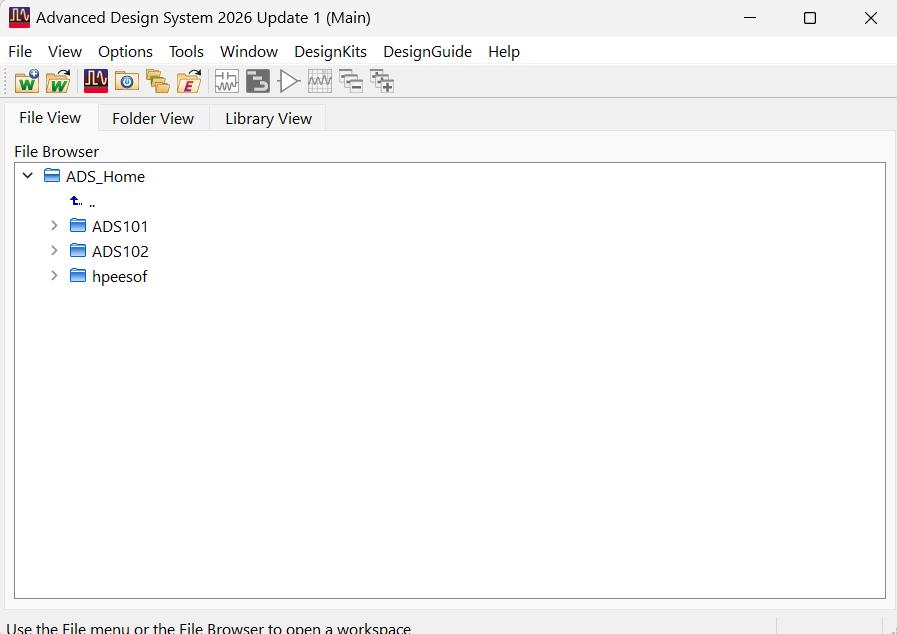
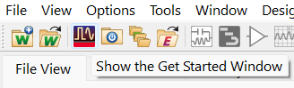
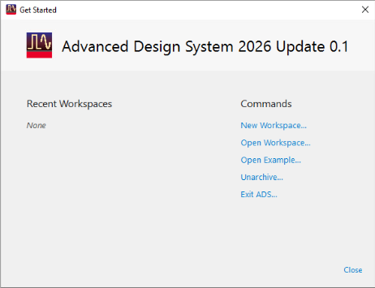

# Lab 01 - Module 1: Start ADS

**Learning Objectives:** In this module, you will complete the following tasks:

- Start ADS
- ADS main window
- ADS home directory
- Get Started window

## Task 1: Start ADS

Click the shortcut icon for ADS on your screen, or use the Start > Programs command to find and start Advanced Designs System.

   

## Task 2: ADS main window

After initialization, the Main window appears. You should also see the Get Started dialog. Close the Get Started window.

   

> **Note:** Notice the Main Window’s Help menu, which has many useful resources. In the Main window, the File View may show existing workspaces.

## Task 3: ADS home directory

The ADS HOME is chosen at installation time and is saved to the registry. It's default is C:\Users\%USERPROFILE%. This is where workspaces are created by default and where configuration variables are stored (in the folder hpeesof).

This lab exercise, ADS HOME directory has configured to C:\ADS_home.

## Task 4: Get Started window

Notice the Get Started icon on the main ADS toolbar.

   

Click this icon brings back the Get Started dialog.

   

Close the Get Started window.

## You have successfully completed Lab 01 - Module 1.
