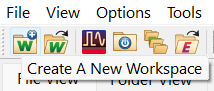
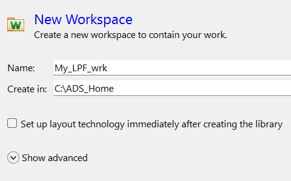

# Lab 01 - Module 2: Create a new workspace using wizard

**Learning Objectives:** In this module, you will complete the following tasks:

- Create a new workspace

## Task 1: Create a new workspace

   

   

1. Click **Create A New Workspace**

1. Set **Name** = **My_LPF_wrk**

1. Set **Create in** = C:\ADS_Home

1. **Uncheck** Set up layout technology...

1. Click **Create Workspace**

## You have successfully completed Lab 01 - Module 2.
