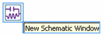
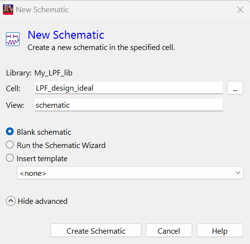
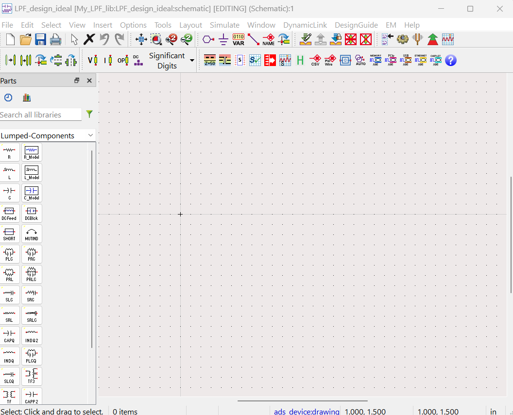
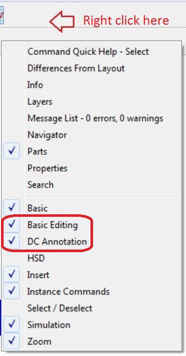
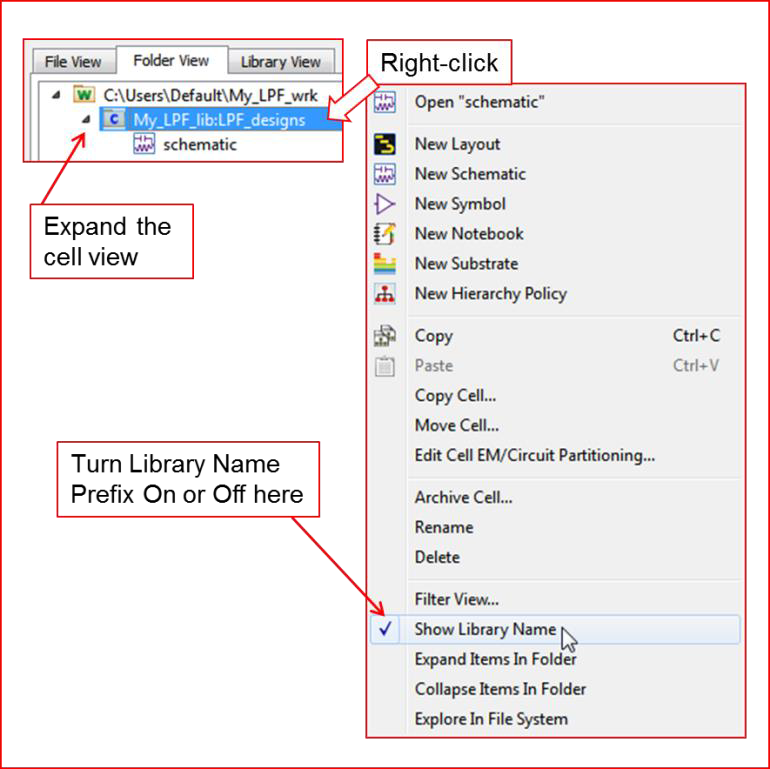

# Lab 01 - Module 3: Creating cells and schematic views

**Learning Objectives:** In this module, you will complete the following tasks:

- Create schematic
- The schematic window will open
- Basic editing and DC annotation
- Show library name

The first step in starting a design is to begin with a blank schematic.

## Task 1: Create schematic

   

   

1. Click **New Schematic Window**.

1. Set **Cell** = **`LPF_design_ideal`**

1. Click **Show advanced**

1. Select **Blank schematic**

1. Click **Create Schematic**

> **Note:** When you create a new schematic, a cell is also created. The default View name for a new schematic is schematic and should generally not be changed.

## Task 2: The schematic window will open

   

## Task 3: Basic editing and DC annotation

1. Right click the tool bar

1. Check **Basic Editing** and **DC Annotation**

   

## Task 4: Show library name

   

1. Right-click on the cell name `LPF_design_ideal`

1. Check **Show Library Name**.

You will see the library name **My_LPF** shown as a prefix

1. Once done turn it off.

## You have successfully completed Lab 01 - Module 3.
