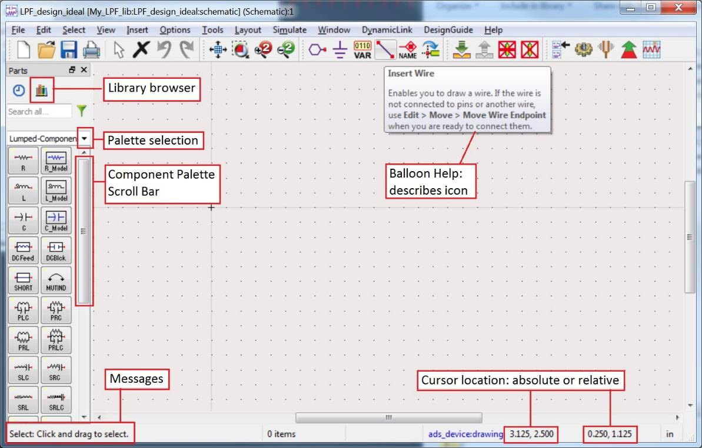

# Lab 01 - Module 4: Schematic window basics for LPF design

**Learning Objectives:** In this module, you will complete the following tasks:

- Familiarize with the schematic window

## Task 1: Familiarize with the schematic window

1. Quickly locating the commands, icons, palette, and cursor location values shown here.

   

1. Click the **Palette selection** to see other palettes.

1. Move the **Component Palette Scroll Bar** down and up to see how it works.

## You have successfully completed Lab 01 - Module 4.