# Lab 01 - Module 5: Inserting and wiring components

**Learning Objectives:** In this module, you will complete the following tasks:

- Lumped-Components palette
- Insert a component
- Copy using reference point
- Shortcut / Hotkeys
- Insert wire and grounds
- Update component value
- Simulation-S_Param palette
- S-parameters and port terminations

## Task 1: Lumped-Components palette

1. Select **Lumped-Components**.

   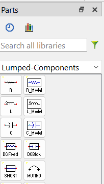

## Task 2: Insert a component

1. Select **C** (Capacitor)

1. Move the mouse into the schematic window.

   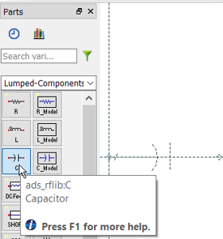

1. Rotate it using either the **Rotate** icon or the shortcut key **(Ctrl+R)**.

1. Left click on the schematic window to place the capacitor.

   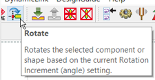

## Task 3: Copy using reference point

   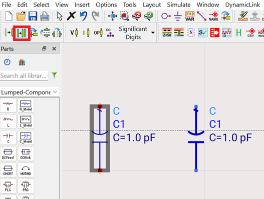

1. Click the "Copy using reference point" icon

1. Select Component C1

1. Drag the mouse to the right and left click to place the copy

1. Press **Esc** key to end the command.

## Task 4: Shortcut / Hotkeys

Try using these icons as you build the design; they are useful.

   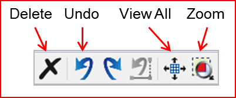

### View All

View All also has the handy shortcut **“F”** (for “Full View”).

### Undo and redo

Undo/redo are typical **Ctrl+Z** and **Ctrl+Y** hotkeys.

## Task 5: Insert wire and grounds

   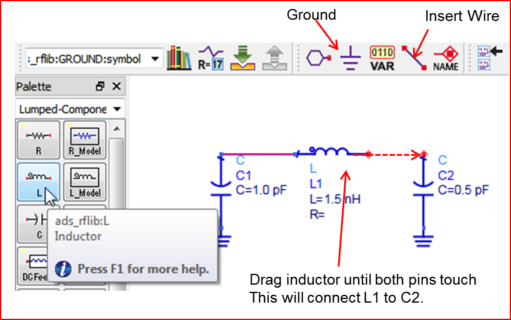

1. Insert the Inductor **L** and grounds

1. Wire the components together by connecting pins and then dragging one of the components or use the  icon.

Try different methods - this will give you practice with schematic capture.

## Task 6: Update component value

   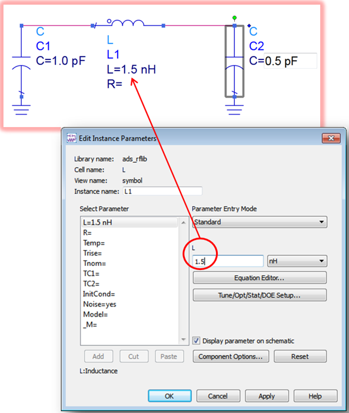

1. Double click the **inductor** symbol

1. Change the value of **L1** = **1.5 nH**

1. Click **OK**

   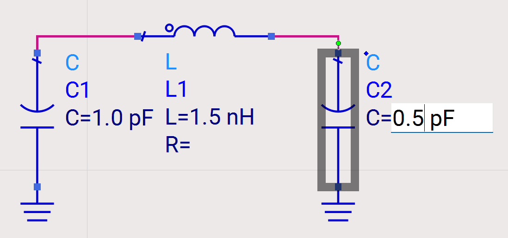

A faster method is to use on-screen editing by **slowly** clicking on the value of a parameter.

1. Change the value of **C2** = **0.5 pF**

## Task 7: Simulation-S_Param palette

   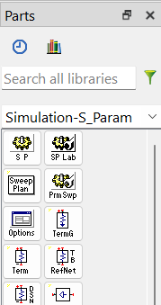

## Task 8: S-parameters and port terminations

   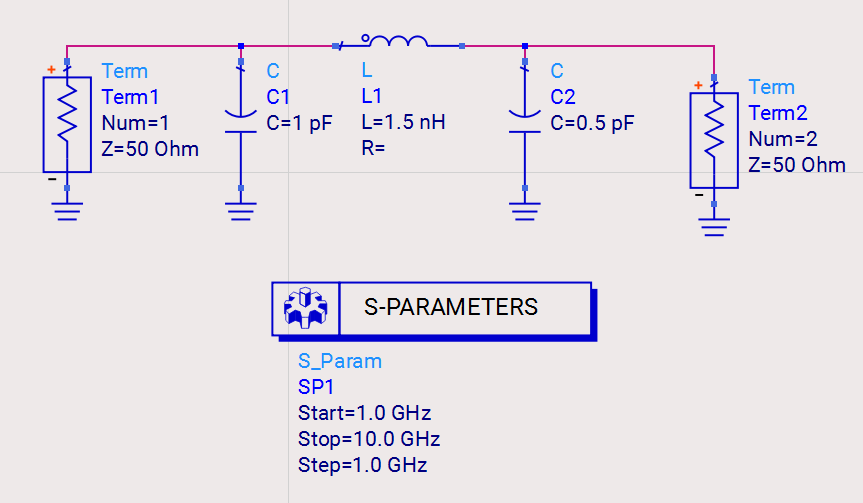

1. Insert the **S-parameter** simulation controller 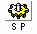

You can also start to type the component name in the Parts search field and when you see what you need, you select it.

1. Insert the port terminations: Term1 and Term2 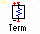

1. Wire and ground them as shown above.

> **Note:** There are also TermG components. These are equivalent to a Term+Gnd components.

## You have successfully completed Lab 01 - Module 5.
