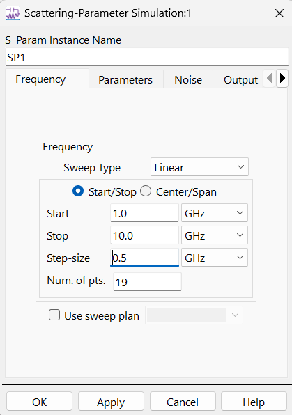
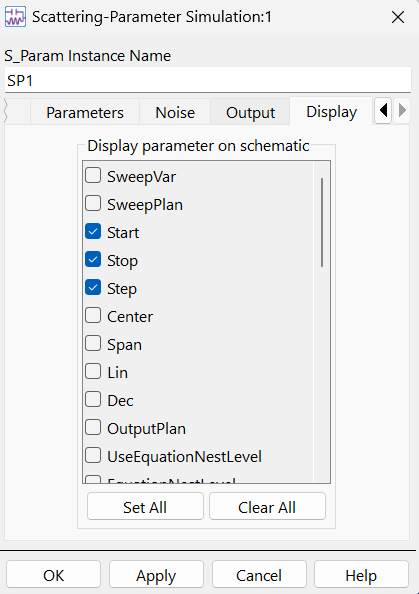
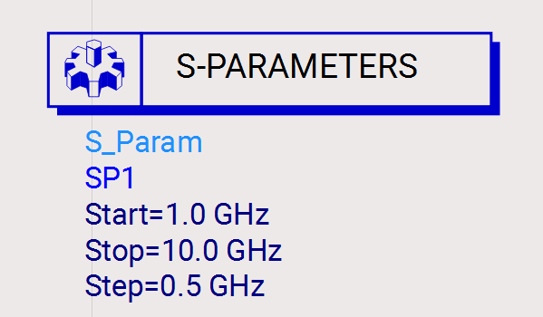

# Lab 01 - Module 6: Simulation setup

**Learning Objectives:** In this module, you will complete the following tasks:

- Frequency setup
- Display parameter
- It should look like this

## Task 1: Frequency setup

   

1. Double click on the **S-parameter** simulation controller

1. Set **Step-size** = **0.5 GHz**

1. Click **Apply**

Notice how it updates the value on the screen. The OK button does the same thing as Apply, and it also dismisses the dialog box - **do not** click OK yet.

## Task 2: Display parameter

   

1. Click the right arrow to scroll the tabs until you see the **Display** tab.

The **Start, Stop** and **Step** values have been checked (by default) to be displayed on the schematic. There are many hidden parameters associated with most components that can be displayed or made invisible on the schematic.

1. Click **OK**.

## Task 3: It should look like this

   

## You have successfully completed Lab 01 - Module 6.
