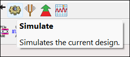
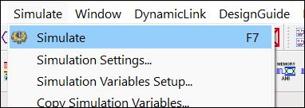
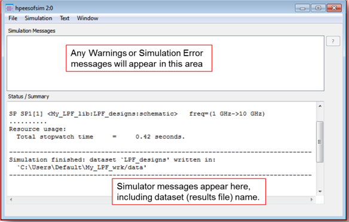
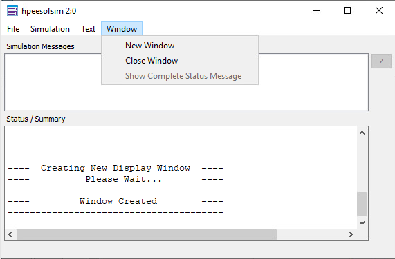
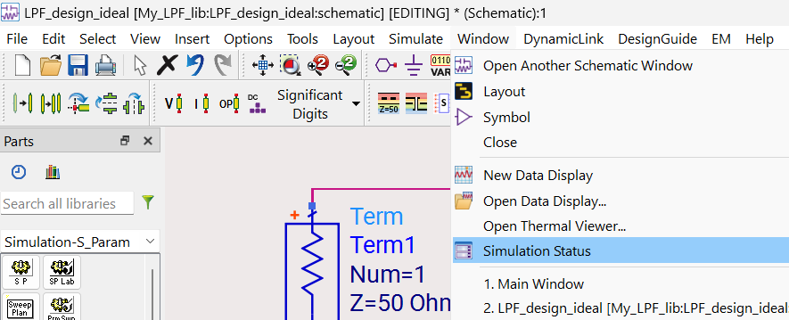

# Lab 01 - Module 7: Launch the simulation and view the status window

**Learning Objectives:** In this module, you will complete the following tasks:

- Launch the simulation

- View the status window

## Task 1: Launch the simulation

1. Click the **Simulate** icon gear

   

1. Alternatively, you could select **Simulate > Simulate** from the menu or press the **F7** key.

   

## Task 2: View the status window

1. Next, look for the Status window to appear and you should see messages similar to the ones here, describing the results of the simulation, the writing of the dataset file, and the creation of a display window.

   

1. If no simulation errors occurred, close the Status window, select **Window > Close Window**.

   

1. You can always recall the status window using the schematic window command: **Window > Simulation Status** (try it).

   

## You have successfully completed Lab 01 - Module 7.