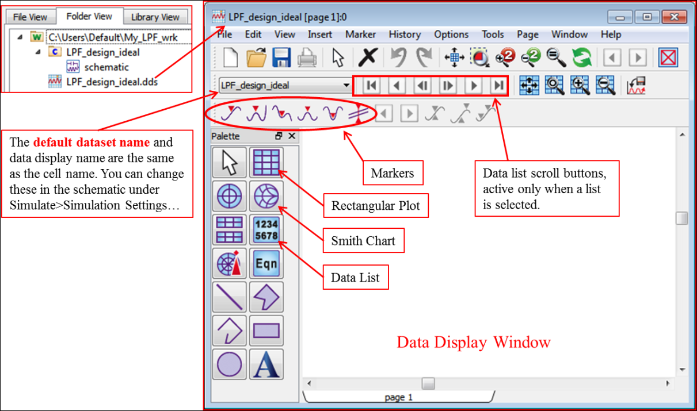
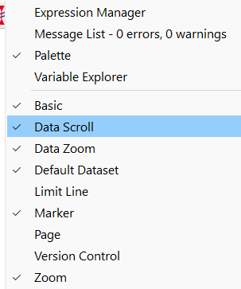
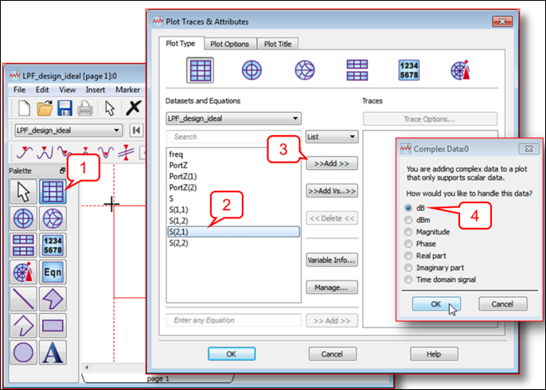
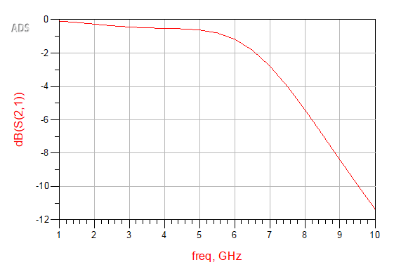
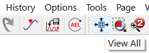
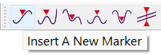
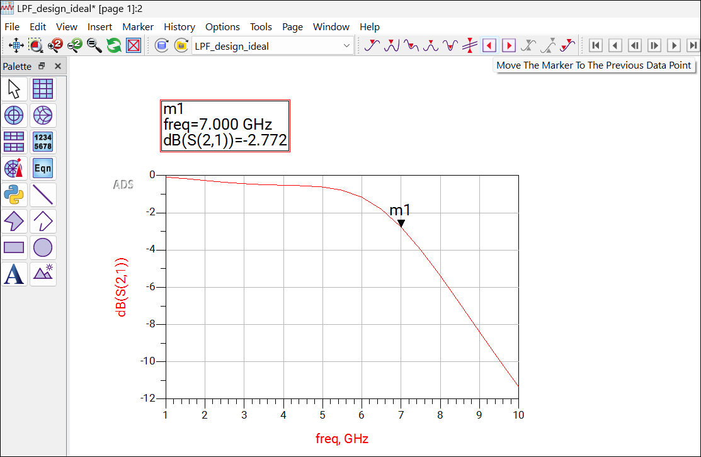
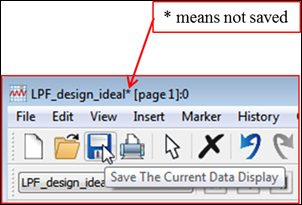

# Lab 01 - Module 8: Data display and plotting data

**Learning Objectives:** In this module, you will complete the following tasks:

- Data display window

- Add data scroll and marker icons

- Plotting data

- Move the marker to get the closest 3dB

- Asterisk (*) and Data display extension (.dds)

## Task 1: Data display window

1. The Data Display window appears with the default dataset ready to plot, list, or for post-processing by writing equations.

1. The default dataset is used for short formatted data strings like S11, S21, etc. unless you explicitly specify another dataset.

   

1. You can have multiple pages of data (see tab at bottom of window). Here, page 1 is blank. Examine the picture shown here.

## Task 2: Add data scroll and marker icons

1. Right click the tool bar and select the check **Data Scroll** and **Marker** to your data display window.

   

## Task 3: Plotting data

1. Click **Rectangular Plot** icon, move the cursor (outlined box) into the window and click

   

1. Select **S(2,1)** data

1. Click the **Add** button

1. Select **dB** as the format for the data

1. Click **OK** in both boxes.

1. It should look like this

   

1. The plot should show a reasonable low pass filter response, If you have a mouse wheel – try using it to zoom in and out.

1. Click **View All** icon to fit the plot in the window

   

## Task 4: Move the marker to get the closest 3dB

1. Click the first marker icon on the toolbar.

   

1. Select the graph and move the marker to find the closest 3dB value

   

## Task 5: Asterisk (*) and Data display extension (.dds)

1. Notice the asterisk at the top of the window. For all the Data Display, Schematic and Layout windows, **the asterisk (*) means it has not been saved**.

   

1. Save the Data Display window and the asterisk disappears.

1. Data Display windows have the file extension .dds which means: data display server, and they are always in the workspace directory – not in the library.

   >**Note:** KEEP THIS WINDOW OPEN for the next steps.

## You have successfully completed Lab 01 - Module 8.