# Lab 01 - Module 9: Tuning parameter values

**Learning Objectives:** In this module, you will complete the following tasks:

- Start the tuner
- Enable parameter for tuning
- Tune the response
- Component parameter update
- Undo the parameter updates
- Run the simulation
- Folder view
- Library view

This step introduces the ADS tuning feature that allows you to tune parameter values and see the simulation results in the data display in real time.

## Task 1: Start the tuner

   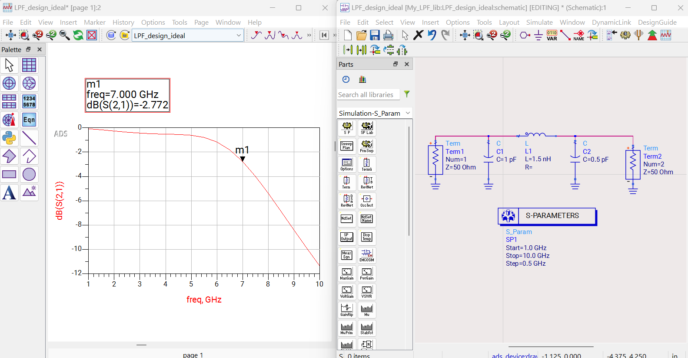

1. Position and resize the data display and schematic windows, so you can see them both on the screen easily.

1. Use **View All** (“**F**” hotkey) to show all contents.

1. Make the schematic window active.

1. Click the **Tuning** icon 

The status window will appear along with the Tune Parameters dialog.

## Task 2: Enable parameter for tuning

1. Click on the **C =1 pF** parameter for capacitor C1 on the schematic.

   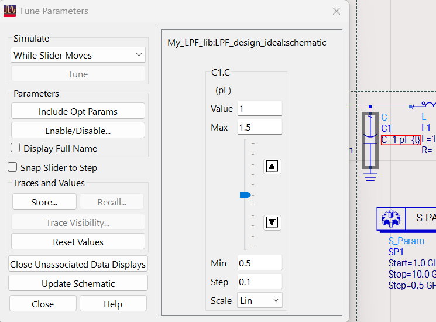

> **Note:** When you do, the tunable parameter will appear in the Tuner and you will see the string {**t**} next to the parameter value that indicates it is enabled for tuning.

1. Add the other capacitor value

1. Add the inductor so that all three component parameters are tunable.

   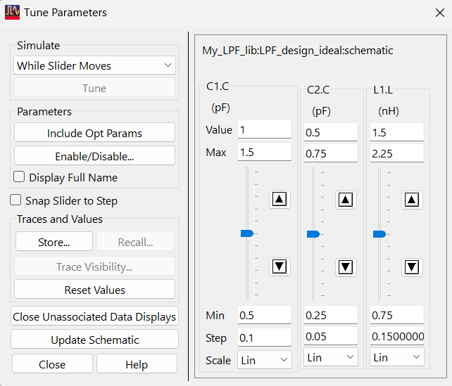

## Task 3: Tune the response

   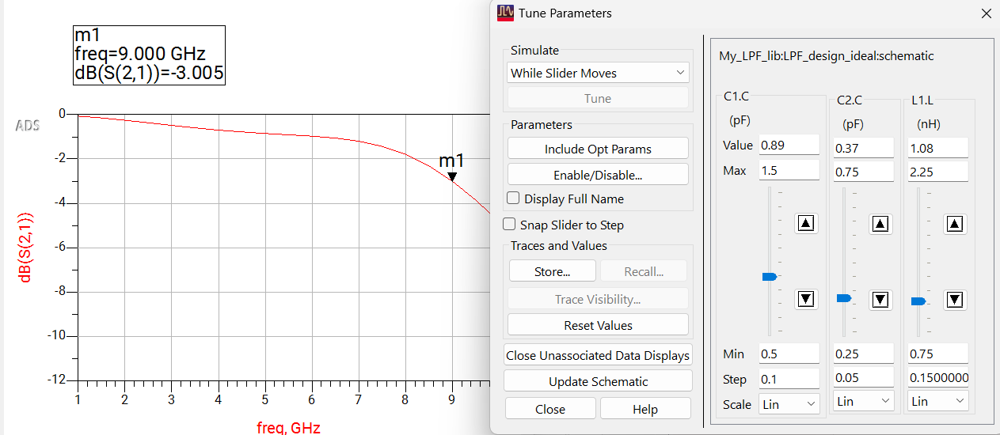

1. Shift the marker to **9 GHz**

1. Tune the response to get -3 dB @ 9 GHz

1. In Tune Parameter window, click 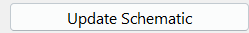

## Task 4: Component parameter update

Those values will appear on the schematic components.

   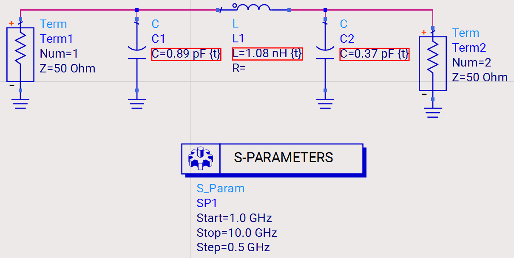

## Task 5: Undo the parameter updates

Take a few moments to experiment with the Tuner and watch the data display and schematic as you do. After experimenting with the tuner, click **Close**.

In the schematic, use **Ctrl+Z** to undo the component parameter updates.

## Task 6: Run the simulation

1. Change **C1** = **0.5 pF**

1. Simulate 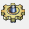

   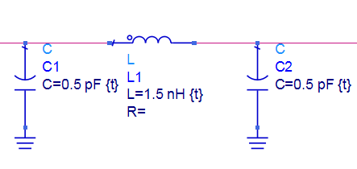

   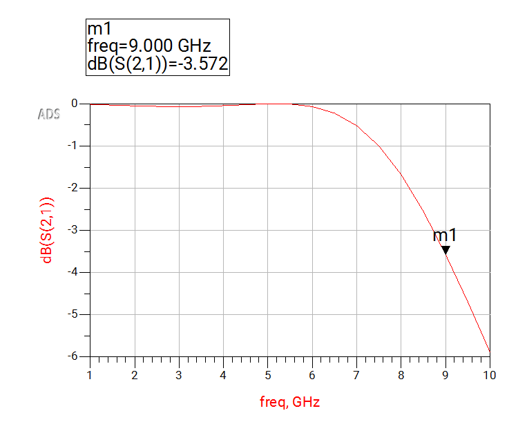

## Task 7: Folder view

The Main window should appear with one cell, one schematic, and one Data Display in the Folder View. Verify this.

   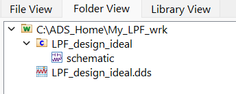

## Task 8: Library view

Look at the Library View which shows all the files for the workspace, including datasets.

   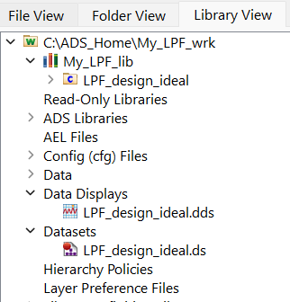

## You have successfully completed Lab 01.
