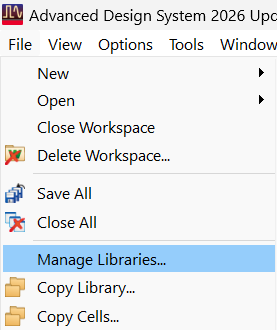
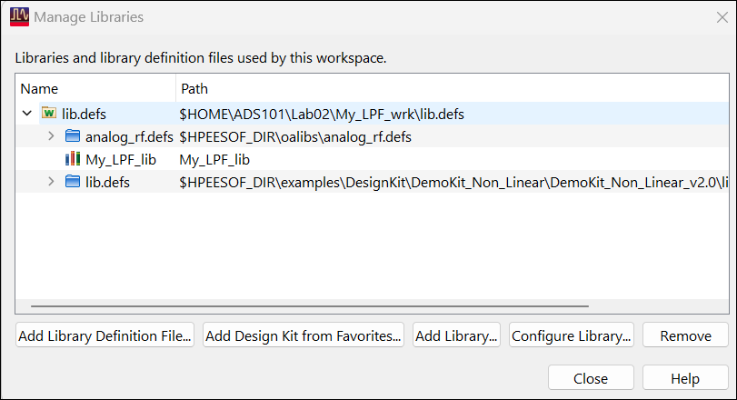
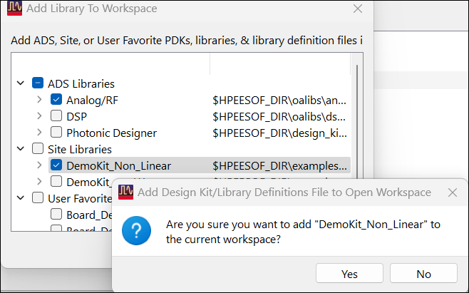

# Lab 2A - Module 1: Adding a reference library to a workspace: using demo PDK

**Learning Objectives:** In this module, you will complete the following tasks:

- Load workspace

- Open the library manager

- Add design kit to workspace (1)

## Task 1: Load workspace

   

1. Click **Open Workspace**

1. Select C:\ADS_Home\ADS101\Lab02\My_LPF_wrk

## Task 2: Open the library manager

1. Select **File > Manage Libraries...** in ADS Main window.

   

## Task 3: Add design kit to workspace (1)

1. Select **Add Design Kit from Favorites...**

   

1. Add design kit to workspace (2)

   

1. Add the **DemoKit_Non Linear** library, click **Yes** to add it

1. Close the Add Library window.

1. Close the library manager.

   >**Note:** Remember that adding a library is referencing it for use. Most foundry PDKs will be read-only and libraries related by workspaces often shared which means they share any changes made to them.

## You have successfully completed Lab 2A - Module 1.