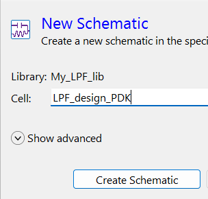
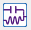
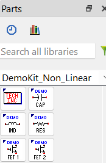
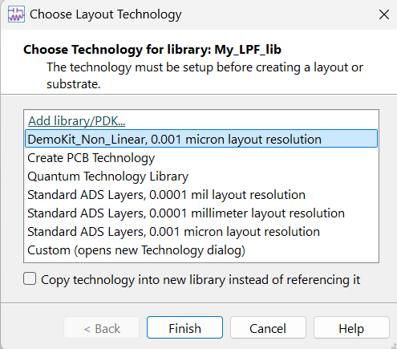
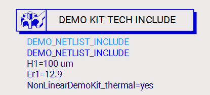
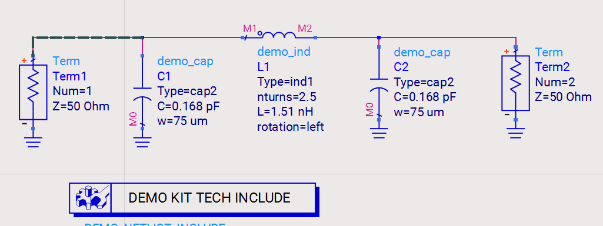
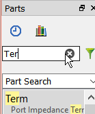
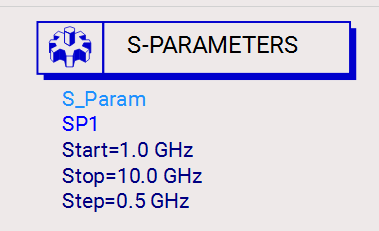
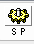
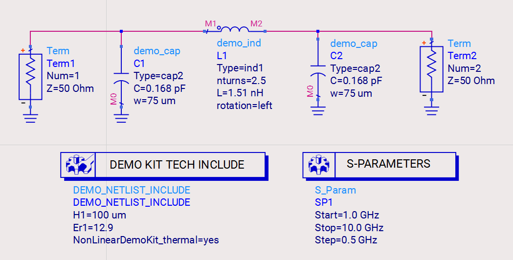

# Lab 2A - Module 2: Build filter using nonideal PDK models

**Learning Objectives:** In this module, you will complete the following tasks:

- Create schematic
- DemoKit_Non_Linear palette
- Build filter

## Task 1: Create schematic

   

1. Add a **New Schematic** 

1. Name the cell **`LPF_design_PDK`**

1. Click **Create Schematic**

## Task 2: DemoKit_Non_Linear palette

Notice that the **DemoKit_Non_Linear** palette is available.

   

## Task 3: Build filter

1. Insert **TechInc** component 

> **Note:** Please note that the Choose Technology for library will pop up when inserting the TechInc component of DK the first time. Click Finish to confirm the usage of the DemoKit technology.

   

> **Note:** The **TechInc** (netlist DEMO KIT TECH INCLUDE) component contains the PDK technology information for the simulator.

   

   

1. Insert Demo_Cap **C1, C2** component.

1. Set **C1 = 0.5 pF,** **C2 = 0.5 pF**

1. Insert Demo_Ind **L1** component

1. Set **L1 nturns = 2.5**

> **Note:** The value of L1 is computed from a callback based on the number of turns (multiples of ¼ turn are allowed) one defines.

1. Insert **Term** component

   

1. Insert wires and ground as shown.

### Insert S-parameter

   

1. Select **Simulation-S_Params** palette

1. Insert **S_Param** controller 

1. Change the simulation step size **S_Param Step = 0.5 GHz**.

### It should look like this

   

## You have successfully completed Lab 2A - Module 2.
