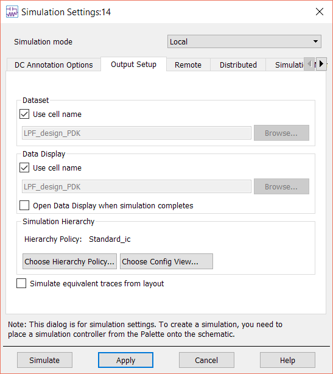
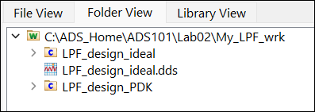
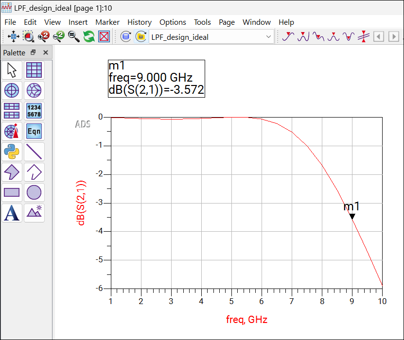

# Lab 2A - Module 3: Simulation settings: data display and dataset names

**Learning Objectives:** In this module, you will complete the following tasks:

- Overview

- Suppress open data display by default and Open data display

## Task 1: Overview

This step shows how to change the default Dataset or Data Display names (which are the same as the cell names).

In general, it is a good idea to keep the default Dataset name because that way, you can always relate a dataset back to the schematic it came from.

## Task 2: Suppress open data display by default and Open data display

1. Click the schematic window menu command: **Simulate > Simulation Settings.**

1. Uncheck the flag **Open Data Display when simulation completes** .

   

1. Click the **Simulate** button

   >**Note:** You can ignore the warnings about the shorted capacitors, which are part of the PDK.

1. Open the Data Display **`LPF_design_ideal.dds`**

   

   

## You have successfully completed Lab 2A - Module 3.