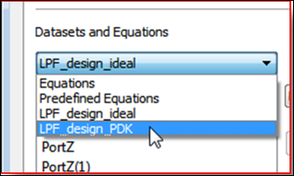
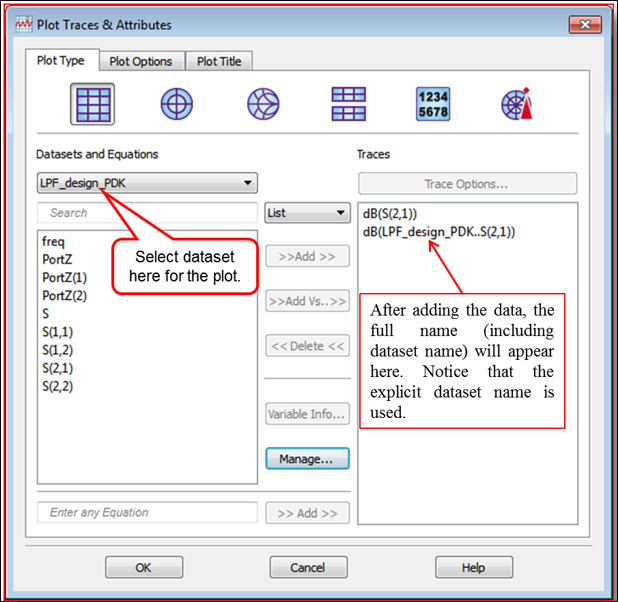
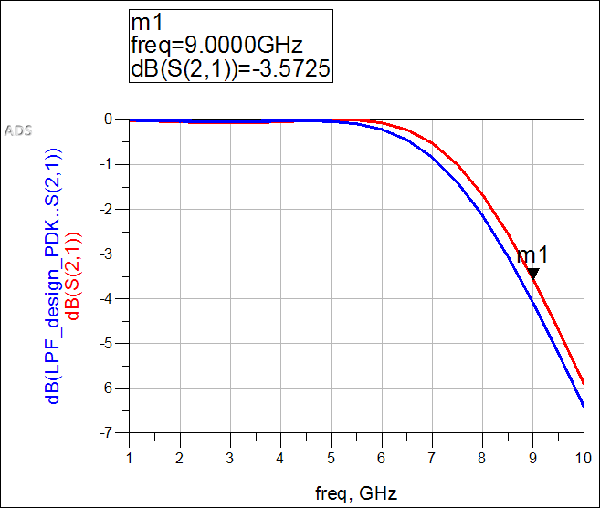
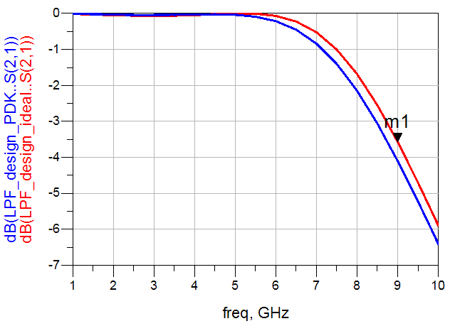

# Lab 2A - Module 4: Different dataset results on one plot

**Learning Objectives:** In this module, you will complete the following tasks:

- Default dataset

- Add different dataset to the plot

- Examine the plot

- Edit trace label

## Task 1: Default dataset

1. In the open Data Display **`LPF_design_ideal`**, double-click the plot (not the trace).

1. When the Plot Traces and Attributes dialog appears, notice the default dataset **`LPF_design_ideal`** that is used to display data from.

   

## Task 2: Add different dataset to the plot

1. Change the dataset to **`LPF_design_PDK`.**

   

1. Add the S(2,1) data in dB.

1. Click **OK**.

## Task 3: Examine the plot

Your plot should be similar to the one shown here.

   

## Task 4: Edit trace label

1. You can edit the trace label **dB(S(2,1))** manually and add the dataset name as in **LPF_design_ideal..dB(S(2,1))** to make it easier to see which data comes from which dataset.

   

1. The two dots indicate that there is hidden information because the complete dataset strings contain additional information that is not needed, such as the *S-parameter instance name* , etc.

1. LPF_design_PDK.SP1.SP.S(2,1) is the complete string for S21 from dataset LPF_design_PDK generated by an SP sim whose instance name was SP1.

1. **Save** the Data Display.

## You have successfully completed Lab 2A - Module 4.