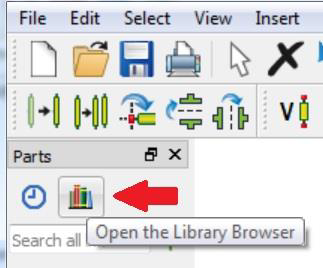
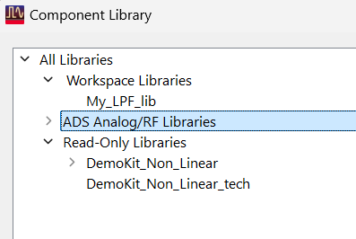
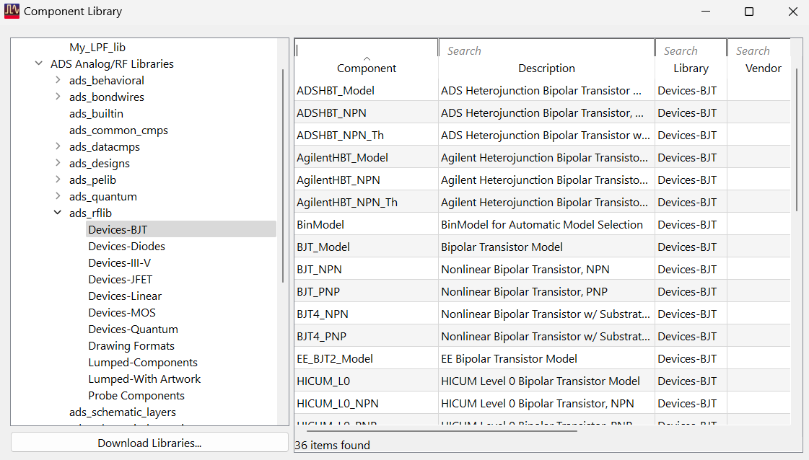
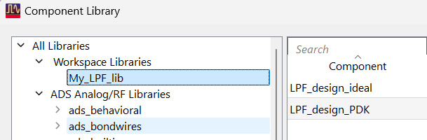

# Lab 2A - Module 5: Component library

**Learning Objectives:** In this module, you will complete the following tasks:

- Overview
- Component library
- ADS RF libraries
- My_LPF_lib

## Task 1: Overview

The Component Library browser is another way to insert components or sub-circuits into schematics or layouts.

## Task 2: Component library

1. In the **`LPF_design_PDK`** schematic, click on the **Component Library Browser** icon.

   

The Component Library shows all workspace and referenced libraries you have loaded in your workspace. In this case, it includes the Analog/RF library and the DemoKit PDK.

   

## Task 3: ADS RF libraries

1. Expand the **ads_rflib**.

Use your cursor to resize columns. You can search each column independently.

   

## Task 4: My_LPF_lib

1. Expand the Workspace Libraries branch

1. Select **`My_LPF_lib`**

   

This is the library that you created with the workspace. You can see your cells and insert these components from here by right-clicking on them and selecting ***Place Component*** . However, the circuit schematics need to have a symbol view first which you will learn how to do in the next lab.

**Save** and **close** any open windows, except the Main window.

## You have successfully completed Lab 2A.
