# Lab 2B - Module 1: Filter design guide

**Learning Objectives:** In this module, you will complete the following tasks:

- Load workspace
- Create a new cell
- Filter DG window
- SmartComponent Overview
- Filter DG - All palette
- Place a smart component
- Select the smart component
- Design smart component
- Frequency setup and simulate
- Examine the data display
- Conclusion

## Task 1: Load workspace

   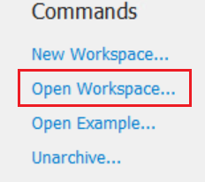

1. Click **Open Workspace**

1. Select C:\ADS_Home\ADS101\Lab02\My_LPF_wrk

## Task 2: Create a new cell

   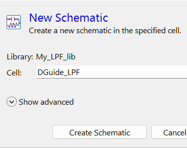

1. Use the Main window schematic icon 

1. Set Cell = **`DGuide_LPF`**

1. Click **Create Schematic**

## Task 3: Filter DG window

   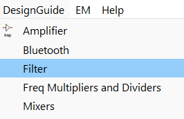

   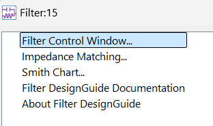

1. Select pull-down command **DesignGuide > Filter**

1. Select the **Filter Control Window**

1. Click **OK**.

## Task 4: SmartComponent Overview

When the Filter DesignGuide control window appears, look at the instructions in the Overview tab. These are the steps that this lab exercise will take you through.

   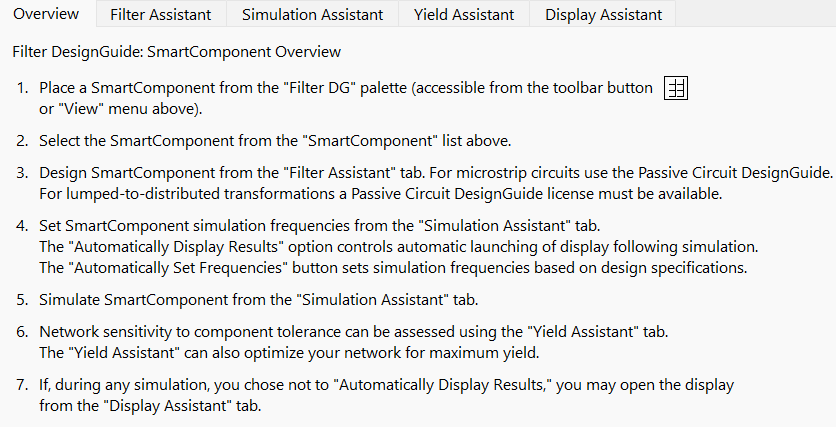

## Task 5: Filter DG - All palette

1. Select the Component Palette button.

   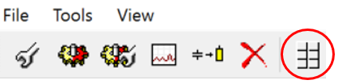

Filter DG - All palette will appear in the schematic.

   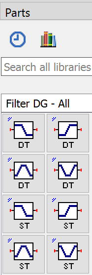

Minimize the Filter DesignGuide window.

## Task 6: Place a smart component

Next, you will select one of the filter types from the palette and insert it into the schematic.

   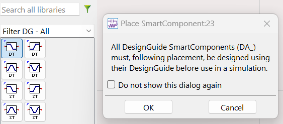

1. Select the **Low_Pass** icon 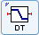

1. Clicking **OK** to the prompt.

1. Insert it into the schematic

> **Note:** This tells the design guide which template to use. In this case, a LC low pass filter.

1. End the insert command from your cursor.

   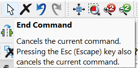

### Smart component

You will see the **DA_LCLowpassDT1** component which is commonly called a Smart Component.

   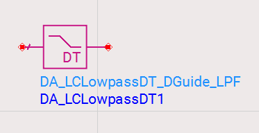

## Task 7: Select the smart component

1. Return to the Filter DesignGuide window.

1. Select the **DA_LCLowpassDT1** component you just inserted.

   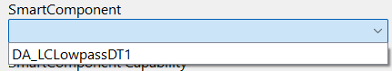

Notice the component in schematic will be highlighted.

   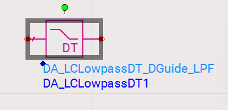

## Task 8: Design smart component

   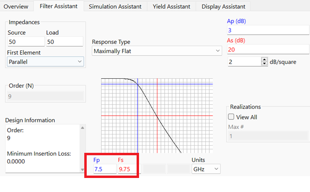

1. Click the **Filter Assistant** tab

1. Change the **Fp** (Passband corner frequency) to **7.5 GHz.**

> **Tip:** The Fs (stopband frequency edge) should change automatically – if not, click in the **Fs** field and it should adjust.

### Build filter

   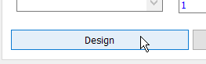

1. Click **Design** button

> **Note:** The filter will be built with the parameters.

### The filter design

**Push into the hierarchy** of the smart component to see the filter design.

   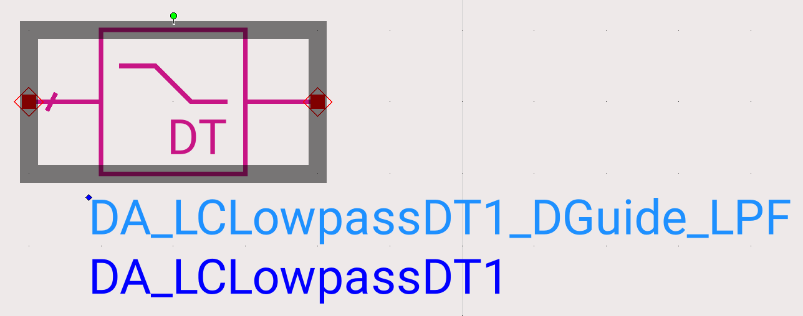

   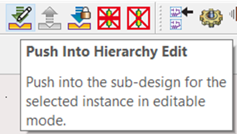

   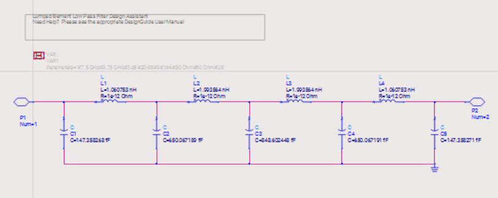

### Pop out

Pop out, back to the upper level hierarchy

   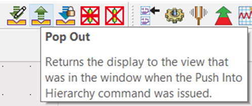

### New cell created

Look at the Main window, you will see the new cell created with the lower level schematic and symbol.

   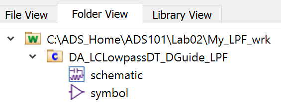

## Task 9: Frequency setup and simulate

   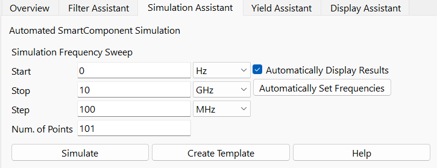

1. Click the Simulation Assistant tab

1. Set **Start = 0**

1. Set **Stop = 10 GHz**

1. Set **Step = 100 MHz**

1. Click the **Simulate** button.

## Task 10: Examine the data display

Look for the data display plotted by the design guide after it runs the simulation. Examine it

   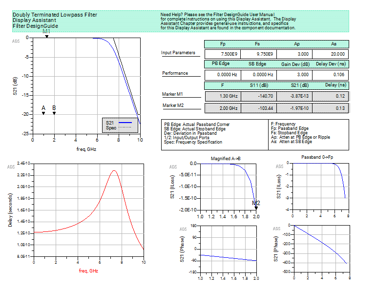

Then close the data display and close the Filter DesignGuide window.

## Task 11: Conclusion

Now, you should have a good idea how to use the filter design guide.

## You have successfully completed Lab 2B.
