# Lab 3A - Module 2: DC FET curve tracer template

**Learning Objectives:** In this module, you will complete the following tasks:

- Create schematic

- DemoKit_Non_Linear palette

- Build schematic

- Begin the simulation

- How a sweep within a sweep is done in ADS?

## Task 1: Create schematic

1. Click **New Schematic Window** 

   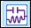

1. Name the new cell **`FET_curves`**

   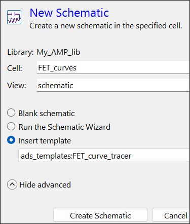

1. Select **ads_Templates:FET_curve_tracer**

1. Click **Create Schematic**

## Task 2: DemoKit_Non_Linear palette

1. In the new schematic, select the **DemoKit_Non_Linear** palette

   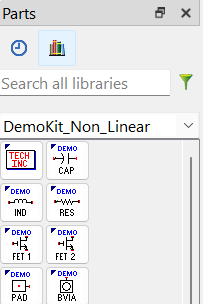

1. The **TechInc** (netlist DEMO KIT TECH INCLUDE) component contains the PDK technology information for the simulator.

## Task 3: Build schematic

1. Insert **DEMO_NETLIST_INCLUDE**. 

   

1. Insert **demo_fet1**. 

   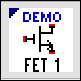

1. The FET 1 text may overlap other text, components or wires. Move the component text using the fn+F5 keyboard key.

   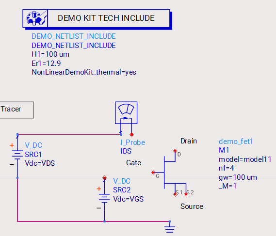

### Wire components

   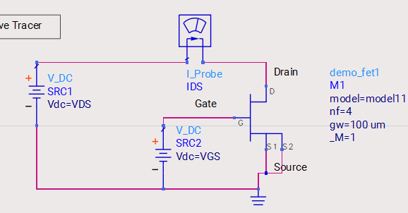

1. Use  Wire FET (D) drain node to I_Probe.

   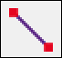

1. Wire both FET source nodes (S1 and S2) to ground.

1. Wire FET (G) gate node to V_DC

1. **Save** the schematic.

## Task 4: Begin the simulation

1. Click **Gear** icon

   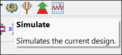

1. On the upcoming message, check **Don't show this message again**

1. Click **Run Anyway**

1. Notice the status window and the data display will pop up immediately after.

   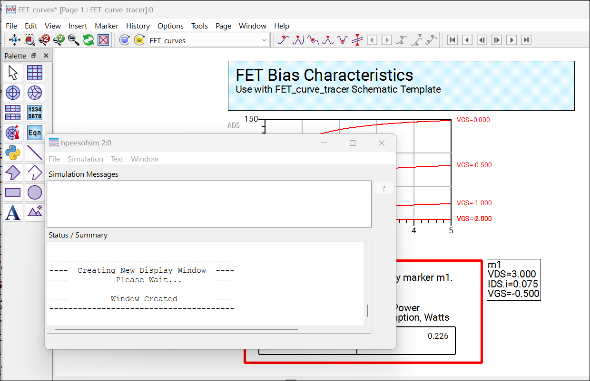

## Task 5: How a sweep within a sweep is done in ADS?

1. Notice that for each value of VGS, VDS is swept from 0 to 5 volts.

   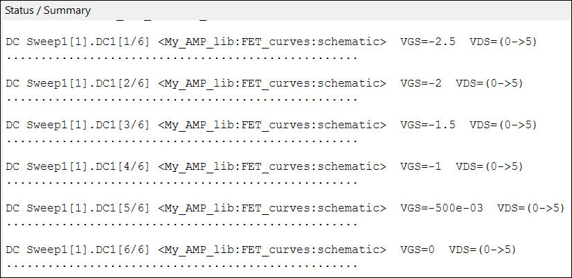

1. Compare the Status information to the Parameter Sweep and DC simulation in schematic

   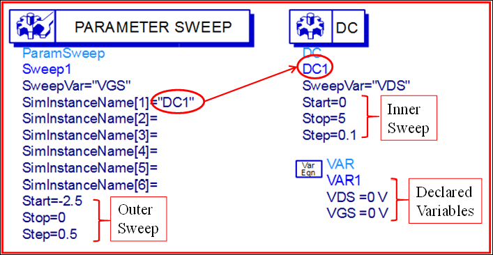

   >**Note:** Notice that the variables must first be declared before they are used. The initial value is not used for the sweep, so they could be 0 volts or 100 volts when declared and the swept values will over-ride them.

## You have successfully completed Lab 3A - Module 2.