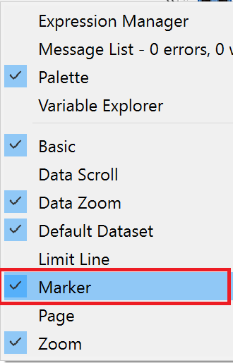
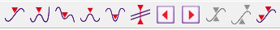
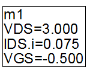
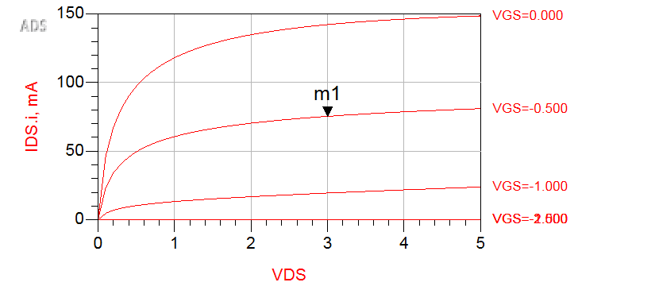
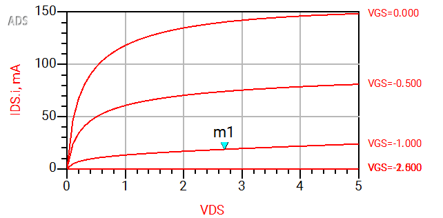
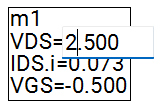

# Lab 3A - Module 3: Experiment with markers

**Learning Objectives:** In this module, you will complete the following tasks:

- Add marker icons
- Examine marker value
- Using marker arrow icon
- Using keyboard arrow keys
- Type in different VDS

## Task 1: Add marker icons

1. In data display window, right click the tool bar

1. Add Marker icons to your data display window.

   

   

## Task 2: Examine marker value

In the Data Display plot, the marker value should appear at VDS=3V and VGS=-0.5V with 75 mA of drain current.

   

## Task 3: Using marker arrow icon

   

1. Select the marker m1

1. Use the marker arrow icon  to move to different values.

## Task 4: Using keyboard arrow keys

   

1. Select and drag marker m1 to another trace

1. Use your keyboard arrow keys to move the marker.

## Task 5: Type in different VDS

1. Insert your cursor in the marker readout

1. Type in a different VDS to move the marker.

> **Note:** Notice that the marker readout and the computed power changes as the marker position changes.

   

## You have successfully completed Lab 3A.
