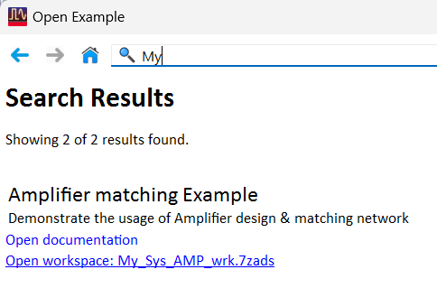
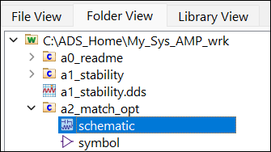
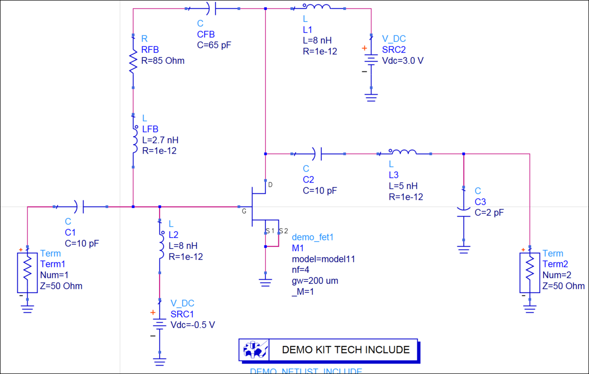
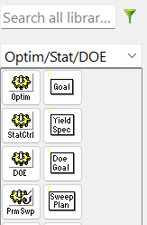
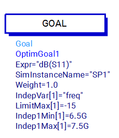
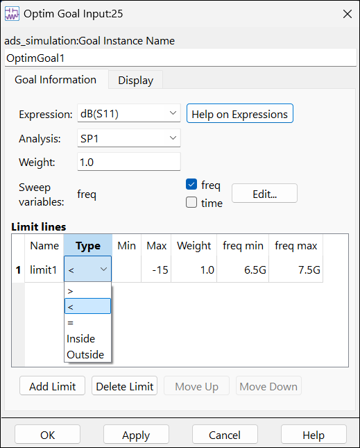
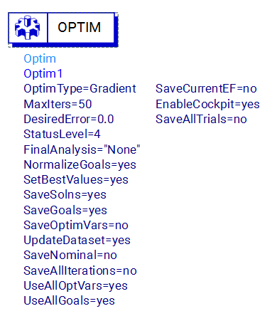

# Lab 3C - Module 1: Optimization controller and goals

**Learning Objectives:** In this module, you will complete the following tasks:

- Open an example workspace

- a2_match_opt

- Optim/Stat/DOE palette

- Goal setup

- Optimizer setup

## Task 1: Open an example workspace

1. Use the icon to open an example workspace

   

1. Type the string **My**

   

1. Click link Open workspace: My_Sys_AMP_wrk.7zads

1. Unarchive it to C:\ADS_Home

1. Click **Finish**

## Task 2: a2_match_opt

1. Open the schematic view for cell **`a2_match_opt`**.

   

1. This is the same stable amplifier with an added output match circuit formed by L3 and C3. The input match is formed by C1 and L2.

   

## Task 3: Optim/Stat/DOE palette

In this schematic, the optimization controller and the goals have been set up for you to save time. These components are located on the Optim/Stat/DOE palette.

1. Select Optim/Stat/DOE palette

   

## Task 4: Goal setup

1. Double click **OptimGoal1**

   

1. The expression **dB(S11)** is evaluated during the simulation and is used for evaluating the limit lines. The analysis is set to **SP1**

1. The checkmark next to the variable **freq** adds it as columns to the limit lines, so that the goal can be specified differently over different frequency ranges (e.g., for filters). **freq min & freq max** are set to 6.5G and 7.5G. This means that this optimization goal will only be evaluated from 6.5 GHz to 7.5 GHz. **G** is equivalent to **e9**, as ADS only parses the units.

1. In the limit lines, the type has been set to &lt; (less than). This tells the optimizer that this goal must be -15 dB (max value) or less for a successful optimization.

   

1. Click **OK**.

## Task 5: Optimizer setup

   >**Note:** The **optimizer type** has been changed to Gradient because it is much more efficient for this problem than Random.

1. **MaxIter = 50** means that the optimizer will run for up to 50 iterations to achieve the goals.

   

1. The **Normalize goals** setting means that all goals will have equal weighting.

1. The **‘Save’ parameters** are set to ‘no’, means that those values will not be written into the dataset.

## You have successfully completed Lab 3C - Module 1.