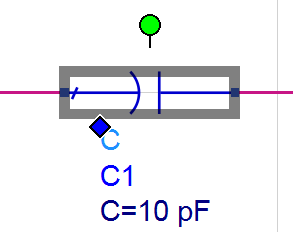
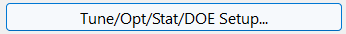
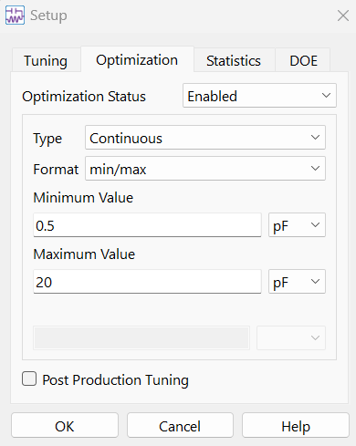
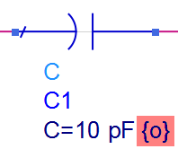
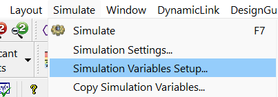
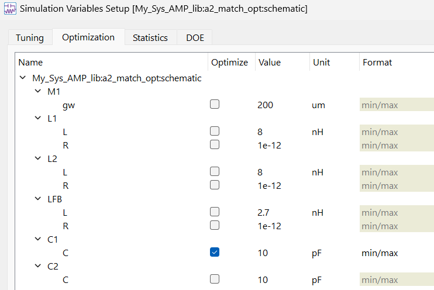
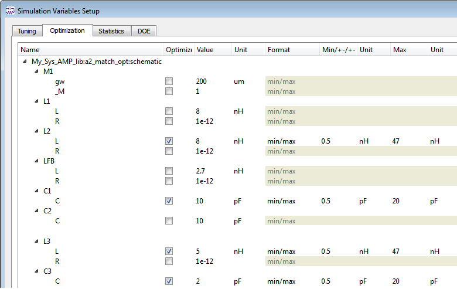
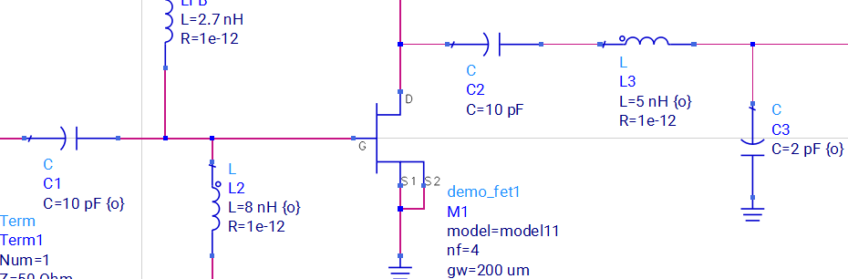

# Lab 3C - Module 2: Enabling variables to be optimized

**Learning Objectives:** In this module, you will complete the following tasks:

- Enable single component to be optimized
- Enable multiple variables to be optimized

## Task 1: Enable single component to be optimized

1. Double click the input capacitor (C1).

   

1. When the dialog appears, click the **Tune/Opt/Stat/DOE Setup** button.

   

   

1. Select the **Optimization tab**

1. Set Optimization Status = **Enabled**.

1. Type in the continuous range: **0.5 pF** to **20 pF**.

1. Click **OK** twice

### Examine component text

   

> **Note:** The component text will show the ***opt*** function {o} next to the capacitance value.

## Task 2: Enable multiple variables to be optimized

Now you know how to enable and display the values for a single component. There is another way to control variables for optimization, especially if multiple variables are to be tuned, optimized, or use for statistical analysis as you will now see.

1. Click the command **Simulate > Simulation Variables Setup**.

   

1. Select the **Optimization** tab.

Notice that your enabled capacitor C1 and values appear. This setup makes it easy to set multiple parameters or variables (VARs).

   

### Enable variables to be optimized

1. In Optimize column, check **C1** , **C3,** **L2**, **L3**

1. Update the values shown here.

|  |  | Optimize | Min | Max |
|---|---|---|---|---|
| L2 | L |  | 0.5 nH | 47 nH |
| C1 | C |  | 0.5 pF | 20 pF |
| L3 | L |  | 0.5 nH | 47 nH |
| C3 | C |  | 0.5 pF | 20 pF |

### It should look like this

   

1. Click **OK** when done.

### Examine component text

The component text of C1, C3, L2, L3 will show opt function {o} next to the value.

   

## You have successfully completed Lab 3C - Module 2.
