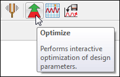
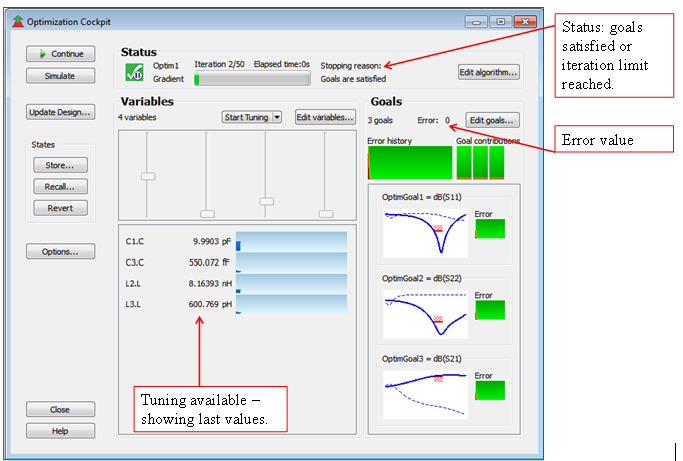
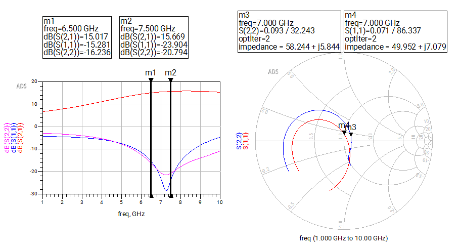
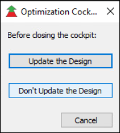

# Lab 3C - Module 3: Running an optimization

**Learning Objectives:** In this module, you will complete the following tasks:

- Run the optimization

- Optimization cockpit

- Notice all goals were achieved

## Task 1: Run the optimization

1. Click the **Optimize** icon

   

   >**Note:** Immediately, you will see the **Optimization Cockpit**, Status window and Data Display appear.

## Task 2: Optimization cockpit

The cockpit shows all the information you need.

   

## Task 3: Notice all goals were achieved

1. In the data display, move the **Line Markers** to **6.5 GHz** and **7.5 GHz**.

1. On the Smith chart, set the markers to **7 GHz**.

   >**Note:** Notice that, all goals were achieved, i.e. S11 &lt; -15 dB, S22 &lt; -15 dB and S21 > 15 dB.

   

### Close optimization cockpit

Click the **Close** button in the Optimization Cockpit – then click the button: **Don’t Update the Design**.

   

This means the L and C values will not be updated

### Save and close

Save and close the schematic and the data display.

## You have successfully completed Lab 3C - Module 3.