# Lab 3C - Module 4: Smith chart utility for Z matching network

**Learning Objectives:** In this module, you will complete the following tasks:

- Create schematic

- Smith chart utility

- Smith chart palette

- Place matching network component

- Smart component sync

- Enter the amplifier impedance

- Build matching network

- Create the matching circuit

- The matching circuit

## Task 1: Create schematic

   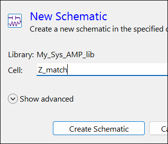

1. In the Main window, click on the icon

   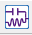

1. Name the new cell **`Z_match`**

1. Click **Create Schematic**

## Task 2: Smith chart utility

1. Click on **Tools > Smith Chart**…

   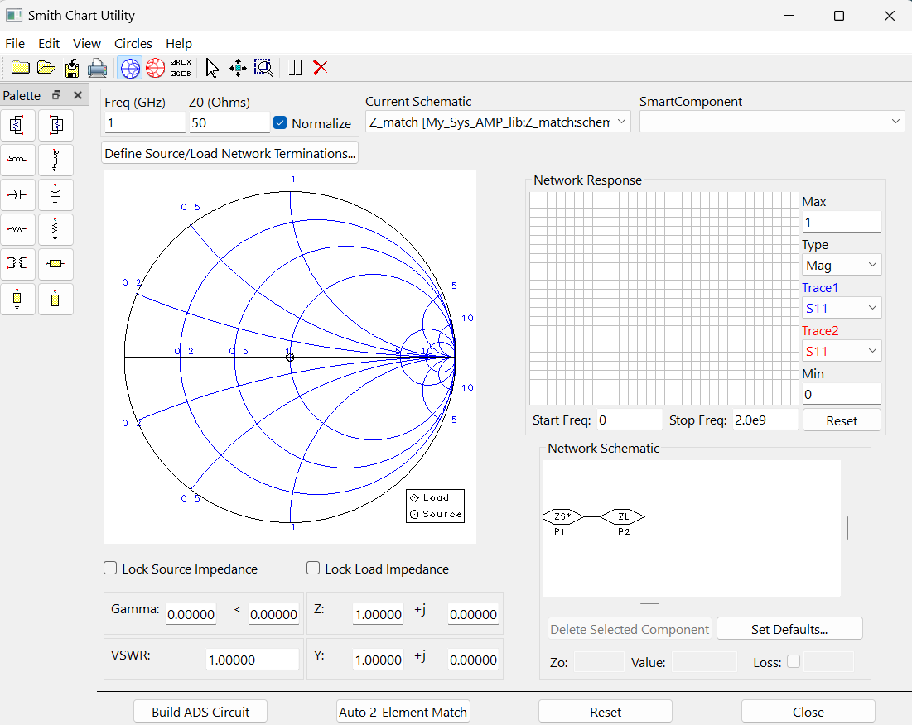

## Task 3: Smith chart palette

1. Click the **Palette** icon shown here.

   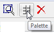

1. This adds the Smith Chart palette with the Smith Chart icon to your schematic.

   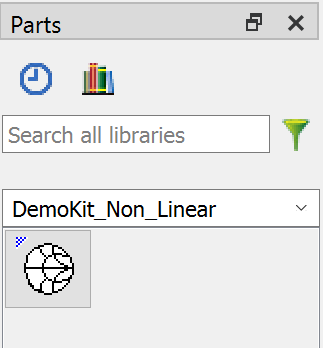

## Task 4: Place matching network component

1. It is necessary to insert this component in a schematic for the tool to be used.

   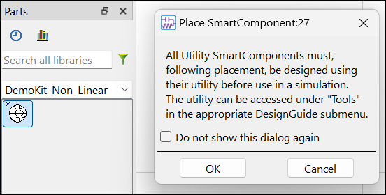

1. Insert the **Matching Network** component.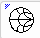

1. Click **OK** when a message dialog appears – you can ignore it.

   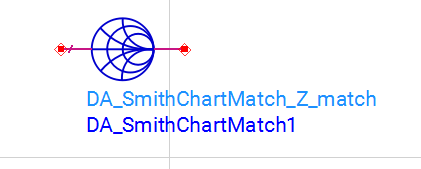

   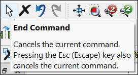

## Task 5: Smart component sync

1. In the Smith Chart Utility (at the top) in the Freq (GHz) field type **7**.

1. Click **Enter**

   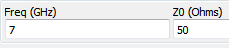

1. **Ignore** the upcoming error message and click OK.

1. When prompted sync the component from the Smith Chart Utility and click OK.

   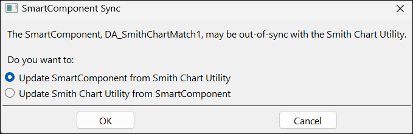

## Task 6: Enter the amplifier impedance

1. Select the **ZL** component (in Network Schematic)

1. Type in the approximate impedance looking into the amplifier: **13-j*63**

   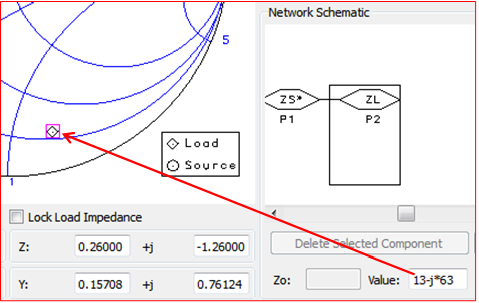

1. Press **Enter**

   >**Note:** Notice that the load symbol (diamond) on the Smith chart has relocated to the lower right.

## Task 7: Build matching network

1. Select the **shunt inductor** from the Smith Chart Utility palette.

   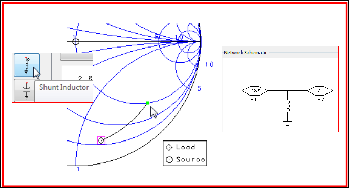

1. Move the cursor on the Smith chart as shown

1. Stop when you get to the 50 Ohm circle of constant resistance. **Click** to stop; it does not have to be exact.

1. Select the **series inductor** from the palette.

   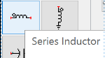

1. Move the marker along the circle to the center of the Smith chart (approximately) and **click**, as shown.

   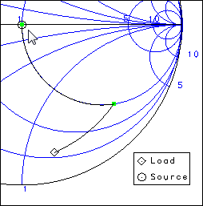

   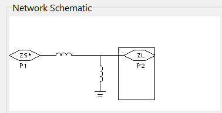

1. In the lower right in the Network Schematic pane, select either shunt or series L to see the value, see here.

   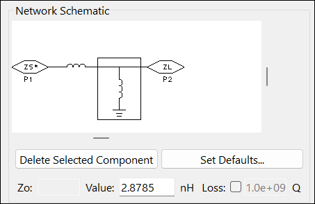

   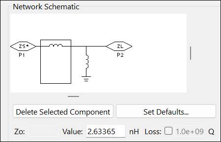

## Task 8: Create the matching circuit

1. Click the **Build ADS Circuit** button at the bottom of the Smith Chart Utility window.

   

1. Now you have designed the matching network that was used to obtain the good results in the previous steps.

   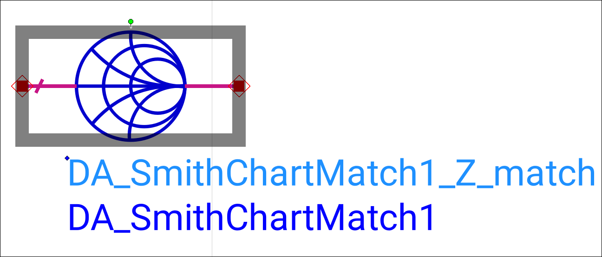

1. **Close** the utility window.

## Task 9: The matching circuit

1. In the **`Z_match`** schematic push into the Smith Chart symbol to see the matching circuit.

   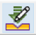

   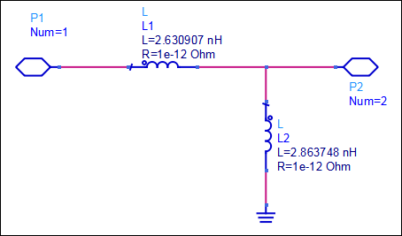

   >**Note:** Notice the values obtain a very close to the rounded value we used in the matching circuit in the lab. Your values may be slightly different.

## You have successfully completed Lab 3C.
