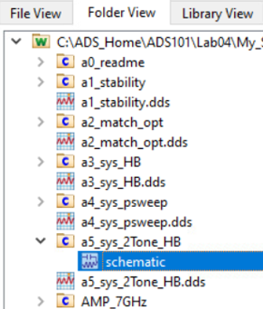
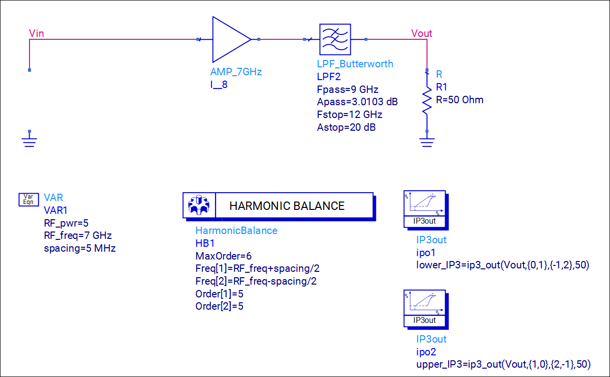
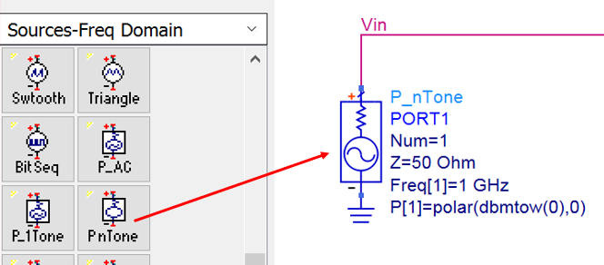
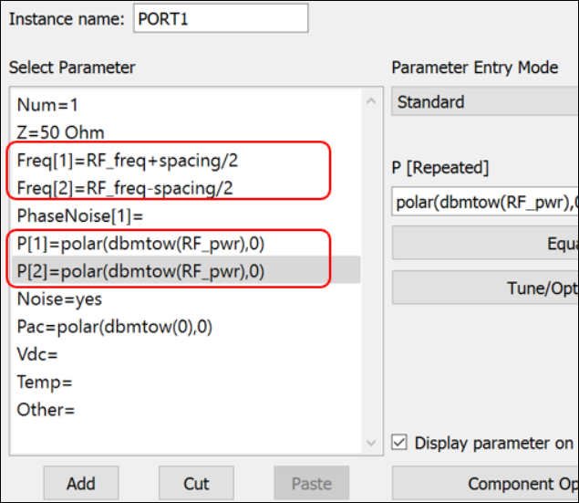
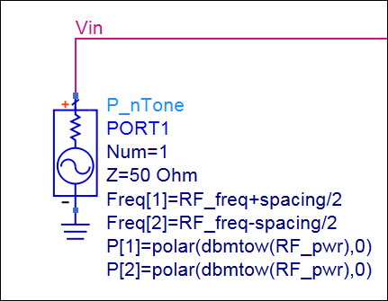
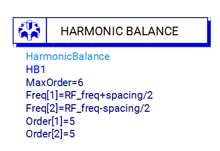

# Lab 4B - Module 1: Two-Tone HB simulation setup

**Learning Objectives:** In this module, you will complete the following tasks:

- Load workspace

- a5_sys_2Tone_HB

- Insert P_nTone source

- Add Freq and P parameter

- Harmonic Balance setup

## Task 1: Load workspace

1. Click **Open Workspace**

   

1. Select **C:\ADS_Home\ADS101\Lab04\My_Sys_AMP_wrk**

## Task 2: a5_sys_2Tone_HB

1. Open the schematic view of cell **`a5_sys_2Tone_HB`**.

   

   

## Task 3: Insert P_nTone source

1. From the **Source-Freq Domain palette,** select a **P_nTone** source

   

1. Place it at the input side of the circuit

## Task 4: Add Freq and P parameter

1. Double click P_nTone source

   

1. Set **Freq[1]** = RF_freq+spacing/2

1. Set **P[1]** = polar(dbmtow(RF_pwr),0)

1. Add **Freq[2]** = RF_freq-spacing/2

1. Add **P[2]** = polar(dbmtow(RF_pwr),0)

1. Click OK

1. It should look like this

   

## Task 5: Harmonic Balance setup

1. On this schematic, the HarmonicBalance controller has already been set for you in order to save time.

   

1. Notice that two analysis frequencies have been set with a 5 MHz spacing between them as we did on the source.

1. The order for each tone has been set to 5 (i.e. we only consider up to the 5th harmonic of each tone in our analysis).

1. MaxOrder is set to 6, (i.e. the maximum intermodulation product that will be part of the analysis is 6).

## You have successfully completed Lab 4B - Module 1.