# Lab 4B - Module 2: Simulating closely spaced tones

**Learning Objectives:** In this module, you will complete the following tasks:

- Run the simulation
- Spectrum of V_out in dBm
- Mixing table
- tones equation
- spec_zoom equation
- Plot spec_zoom equation
- Change trace type to spectral
- Now you can clearly see the tones

## Task 1: Run the simulation

   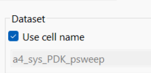

1. Click on **Simulate > Simulation Settings**

1. Check the flag **Use cell name**.

1. Click **Apply**

1. Click **Simulate**.

1. Click Yes on the upcoming message

## Task 2: Spectrum of V_out in dBm

1. **Plot** the spectrum of **V_out** in **dBm**. 

Notice that you must zoom in on the plot or change the X axis scaling to see the closely spaced tones.

   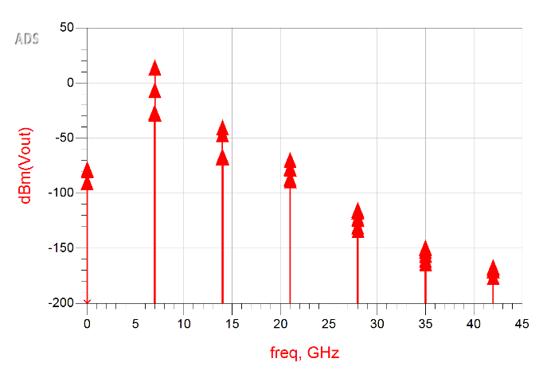

Try both methods quickly because the next steps show a better technique using equations.

## Task 3: Mixing table

1. Insert a List 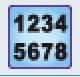of the **Mix** variable as shown here.

Notice that with two tones, you get two Mix columns and the resulting products. On this list, you can see how the index values correspond to the frequencies.

   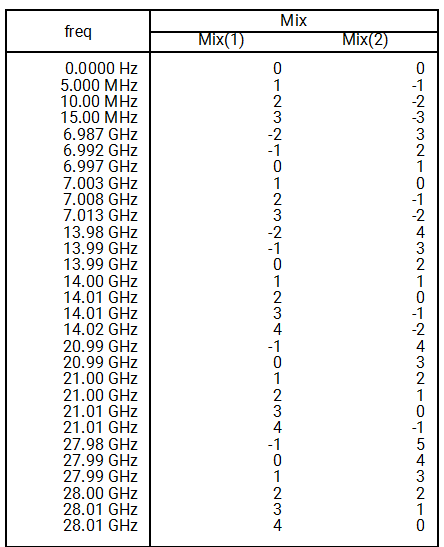

1. Increase Significant Digits from 3 to 5 in order to show freq data more accurately.

   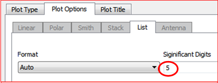

   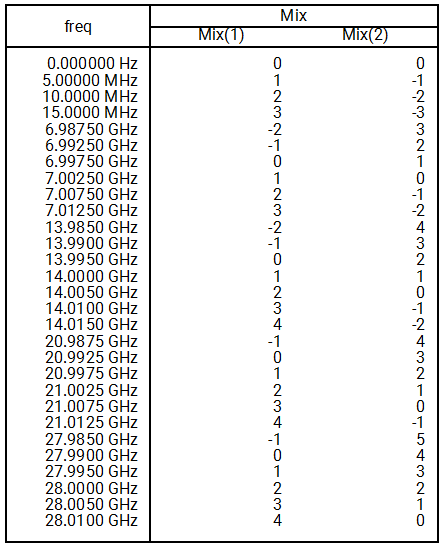

Next, let's create a matrix with vectors (index values) for the desired tones: 4 shown shaded in the list. These are the two fundamental tones plus the 3rd intermod products.

   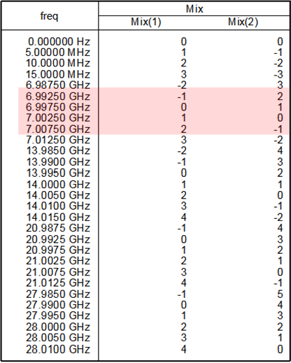

## Task 4: tones equation

   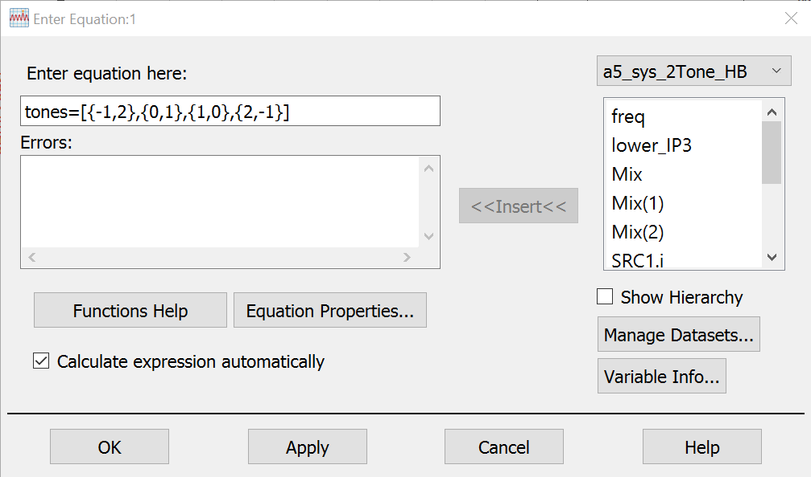

1. On the data display, select the **Eqn** icon 

1. Enter equation: tones=[{-1,2},{0,1},{1,0},{2,-1}]

1. Click **OK**

   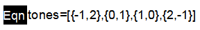

This equation creates a matrix using the square brackets. Within the brackets are curly braces with index values for the mix table.

In this case, the number 1 represents the RF tone with spacing. Zero means that no other tone is desired, and 2 represents two times the RF tone.

## Task 5: spec_zoom equation

   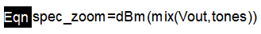

1. Insert **Eqn** icon

1. Enter equation: spec_zoom=dBm(mix(Vout,tones))

1. Click **OK**

Using the mix function and the tones variable you just created the 4 tones will be selected from the list shown. The mix function would be applied to Vout voltage like mix(Vout, tones). Usually the output is required to be in dBm so the dBm() function will also be used as seen here.

## Task 6: Plot spec_zoom equation

   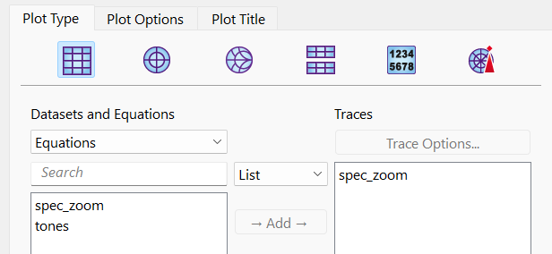

1. Place a new rectangular plot

1. Change *Datasets and Equations* to **Equations**

1. Add **spec_zoom**.

1. Click OK

### Initially it will look like this

Initially it will look like this:

   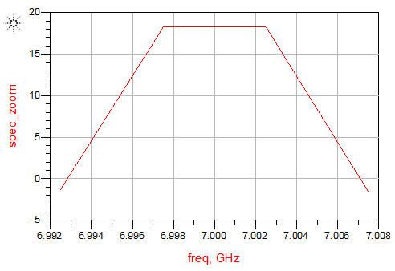

> **Note:** This data is better appreciated in spectral form but because ADS is plotting this from an equation it no longer identifies the type of data so we must change the **trace type**.

## Task 7: Change trace type to spectral

   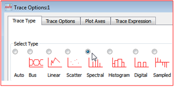

1. Double click on the spec_zoom trace inside the plot.

1. Go to **Trace Options > Trace Type**

1. Change the **Trace Type** to **Spectral**

## Task 8: Now you can clearly see the tones

Now you can clearly see the tones you specified.

   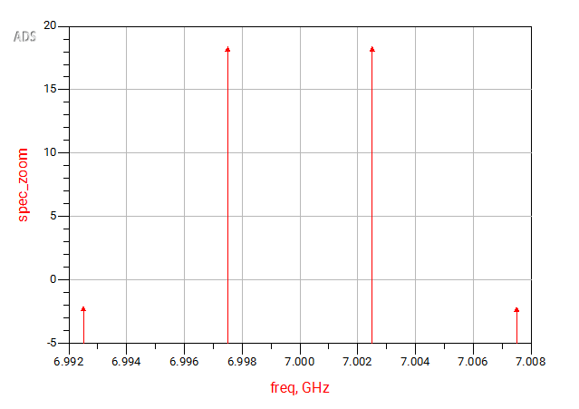

Save the Data Display and the schematic.

## You have successfully completed Lab 4B - Module 2.
