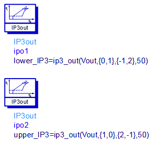
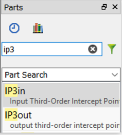
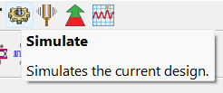
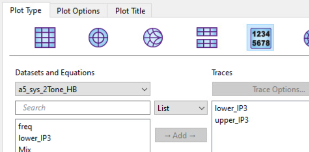
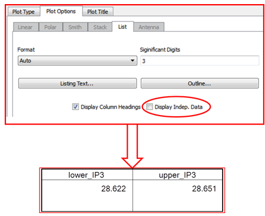

# Lab 4B - Module 3: IP3 simulation (Third Order Intercept Point)

**Learning Objectives:** In this module, you will complete the following tasks:

- upper_IP3 and lower_IP3 equation
- Run the simulation
- Amplifier TOI values

## Task 1: upper_IP3 and lower_IP3 equation

In the schematic, note the two pre-built measurement equations **upper_IP3** and **lower_IP3**. These measurements require a two-tone HB setup. The impedance argument, 50, is OK here because we have matched the output to 50 ohms.

   

These can be found in the *Simulation-HB* palette or by typing **ip3** in the parts search field.

   

   

## Task 2: Run the simulation

**Save the design** and **run the simulation**.

   

## Task 3: Amplifier TOI values

1. In the data display, use list the two measurement equations for **lower_IP3** and **upper_IP3**.

   

1. Remove the independent variable (freq) by using Plot Options – uncheck **Display Independent Data**

1. Here the amplifier TOI values appear reasonable and almost symmetrical.

   

## You have successfully completed Lab 4B.
