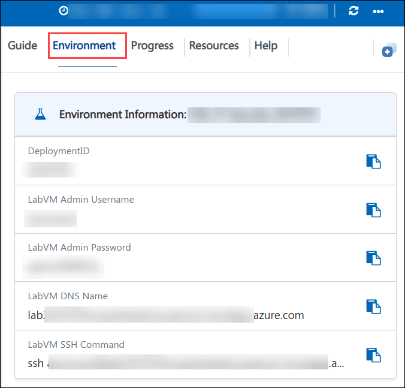
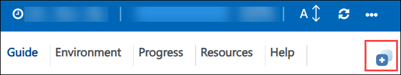
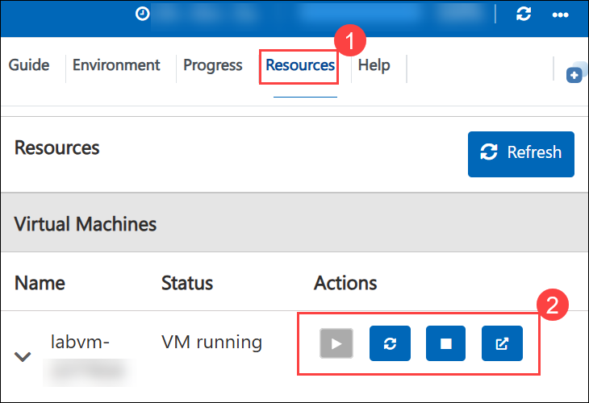
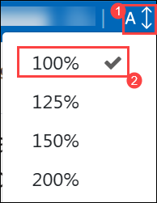

# ADS101: FET Amplifier Design and RF System Analysis

### Estimated Duration: 8 Hours

## Overview

This hands-on lab is made up of two ADS101 labs, completed in sequence:

- **Lab 3B: FET Amplifier Design and Linear Analysis** (120 Minutes): This lab covers FET amplifier schematic and symbol design, DC/AC simulation with bias annotation, noise and frequency analysis, and advanced parameter sweeps using variable equations.

- **Lab 4A: RF System and Non-linear Analysis** (90 Minutes): This lab walks you through RF system design, single-tone HB simulation, frequency and power sweeps, and amplifier distortion modeling, culminating in the simulation of a real PDK amplifier.

## Getting started with your lab

Welcome to your Keysight Advanced Design System (ADS) hands-on lab. This environment gives you a Windows 11 virtual machine with **Advanced Design System 2027** pre-installed, along with the lab workspaces you need to complete each module.

## Accessing Your Environment

Your virtual machine and this **Guide** are available within your web browser.

   

## Environment Details

> **Note:** This environment uses **browser-based RDP** by default. If you'd prefer, you can instead connect via RDP from your local computer's terminal.

1. You can connect to the VM directly from the assessment interface, or by using **Remote Desktop (RDP)** if needed.

    - **VM DNS Name:** <inject key="VM DNS Name" enableCopy="true"/>

    - **Username:** <inject key="VM Username" enableCopy="true"/>
    
    - **Password:** <inject key="VM Password" enableCopy="true"/>

1. Your Deployment ID for this run is **<inject key="DeploymentID" enableCopy="false"/>**. Quote it if you contact support.

## Exploring Your Resources

To get a better understanding of your resources and credentials, navigate to the **Environment** tab.

   

## Utilizing the Split Window Feature

For convenience, you can open the guide in a separate window by selecting the **Split Window** button from the top right corner.

   

## Managing Your Virtual Machine

Feel free to **Start, Restart,** or **Stop** your virtual machine as needed from the **Resources** tab. Your experience is in your hands!

   

## Guide Zoom In/Zoom Out

To adjust the zoom level for the environment page, click the **A↕: 100%** icon located next to the timer in the environment.

   

## Lab Structure

| Lab | Module | Topic |
|-----|--------|-------|
| Lab 3B | Module 1 | Create amplifier workspace |
| Lab 3B | Module 2 | Build the FET amplifier schematic and symbol |
| Lab 3B | Module 3 | Amplifier DC and AC simulations |
| Lab 3B | Module 4 | AC and DC simulation setup |
| Lab 3B | Module 5 | DC annotation in schematic |
| Lab 3B | Module 6 | Noise and AC data result |
| Lab 3B | Module 7 | Variable equation and parameter sweep for simulation |
| Lab 4A | Module 1 | RF system design |
| Lab 4A | Module 2 | Harmonic Balance 1-Tone simulation |
| Lab 4A | Module 3 | Examine the HB data |
| Lab 4A | Module 4 | Variable power sweep setup |
| Lab 4A | Module 5 | Display the swept power data |
| Lab 4A | Module 6 | HB simulation of PDK amplifier system |

>**Note:** Complete Lab 3B first, then Lab 4A. Within each lab, the modules are not independent, so complete them in order.

## Launch Advanced Design System

Click the shortcut icon for ADS on your screen, or use the Start > Programs command to find and start Advanced Designs System.

   

## Support Contact

The CloudLabs support team is available 24/7 via email and live chat.

- Email Support: labs-support@spektrasystems.com
- Live Chat Support: https://support.cloudlabs.ai/isv

Now, click on **Next >>** from the lower right corner to move on to the next page to begin with Lab 3B, Module 1.

   

## Happy Learning !!
