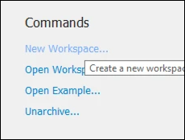
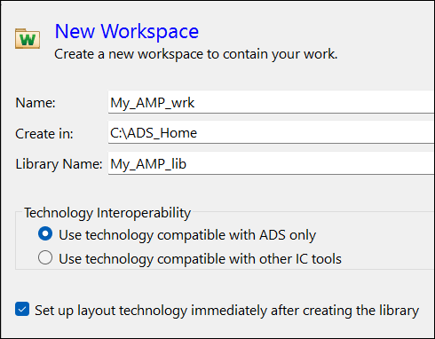
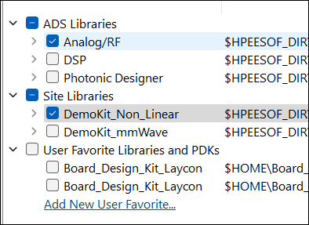
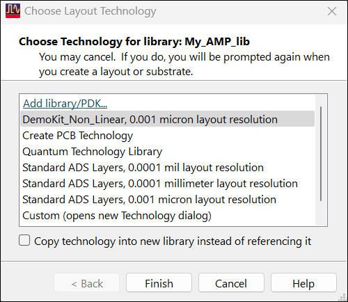

# Lab 3B - Module 1: Create amplifier workspace

**Learning Objectives:** In this module, you will complete the following tasks:

- Create amplifier workspace
- Add library
- Choose Technology for library

## Task 1: Create amplifier workspace

1. Click on the **New Workspace**

   

1. Set **Name** = **My_AMP_wrk**

1. Click Show advanced

1. Check “Set up layout technology immediately..."

1. Click on 

## Task 2: Add library

   

1. Select **DemoKit_Non_Linear** library

1. Click OK

1. Click **Create Workspace**

## Task 3: Choose Technology for library

   

1. Choose DemoKit_Non_Linear, 0.001 micron....

1. Click **Finish**

## You have successfully completed Lab 3B - Module 1.

Now, click on **Next >>** from the lower right corner to move on to the next page.

   
