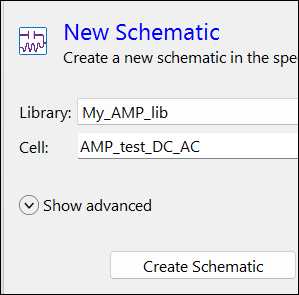
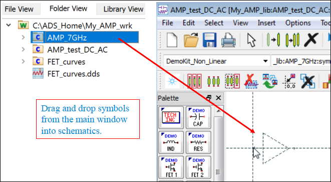
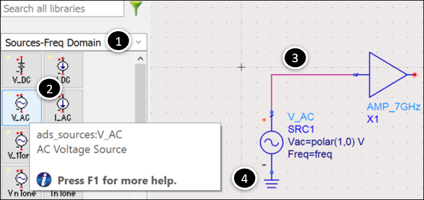
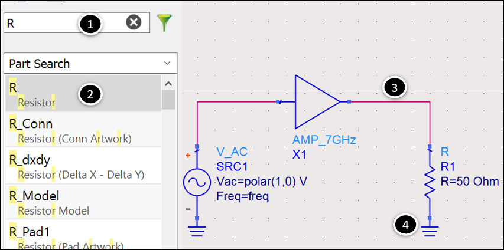
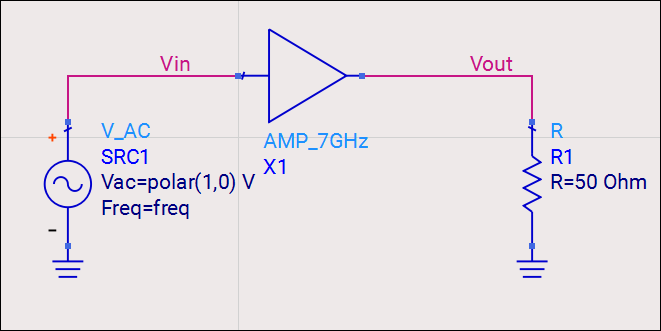

# Lab 3B - Module 3: Amplifier DC and AC simulations

**Learning Objectives:** In this module, you will complete the following tasks:

- Create new schematic
- Insert amplifier symbol
- Insert V_AC source
- Insert resistor
- Place wire label

## Task 1: Create new schematic

1. Click **New Schematic Window**

   

1. Name the new cell **AMP_test_DC_AC**

1. Click **Create Schematic**

   

## Task 2: Insert amplifier symbol

1. **Drag & drop** symbol for the amplifier from the Main window or search for its name in the Parts search field in the schematic.

   

## Task 3: Insert V_AC source

1. Select **Sources-Freq Domain** palette

1. Insert a **V_AC** source.

1. Wire on the input side of the amplifier.

   

1. Add a ground.

   

## Task 4: Insert resistor

1. Type the letter “**R**” in the Parts search field.

1. Insert a **resistor** (CTRL R to rotate).

1. Wire it to the amplifier output

1. Add a ground.

   

## Task 5: Place wire label

In DC and AC simulations, to obtain simulation results, you must have wire labels, current probes and/or power probes in your circuit.

1. Click the **NAME** icon (or menu command: **Insert > Wire/Pin Label** ).

   

1. Select the input wire, type **Vin.**

1. Select the output wire and type **Vout.**

   

## You have successfully completed Lab 3B - Module 3.

Now, click on **Next >>** from the lower right corner to move on to the next page.

   
