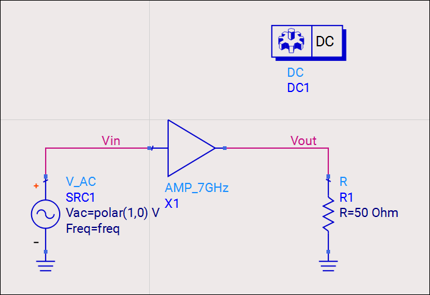
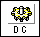
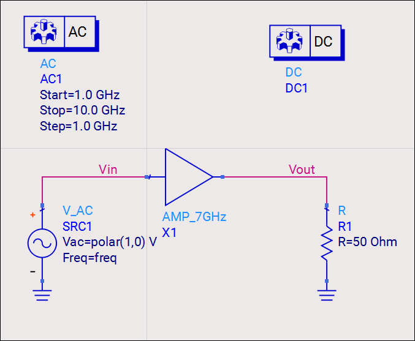
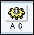
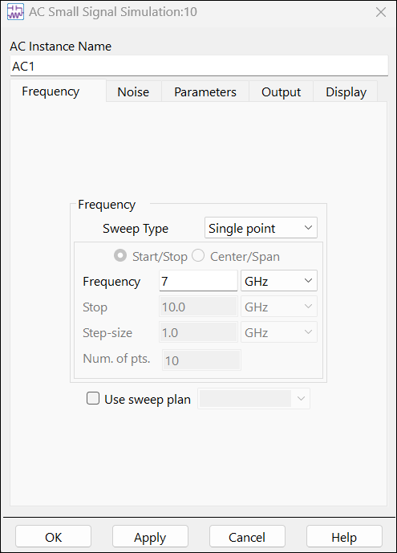
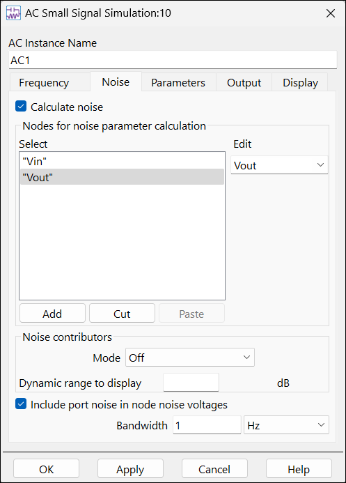
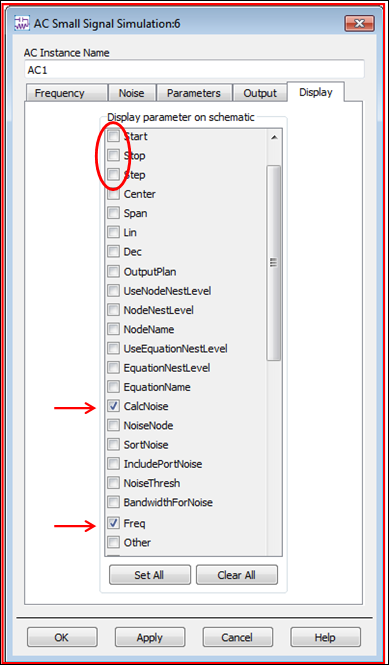
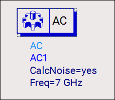

# Lab 3B - Module 4: AC and DC simulation setup

**Learning Objectives:** In this module, you will complete the following tasks:

- DC controller setup

- AC controller setup

## Task 1: DC controller setup

1. Select the **Simulation-DC** palette

   

1. Insert **DC** simulation controller 

   

>**Note:** The DC controller requires no further setup.

## Task 2: AC controller setup

1. Select the **Simulation-AC** palette

   

1. Insert **AC** simulation controller 

   

1. Although the simulation is set-up with a sweep by default, the next step is to change the frequency to exactly 7 GHz and then run the simulation.

   

1. Edit the AC controller (double click)

1. Go to **Frequency tab**

1. Set **Sweep type** = **Single point**

1. Set **Frequency** = **7 GHz**

1. Click **Apply**

All ADS simulation controllers have default setup values. But you usually have to specify the settings you want. Also, it is OK to combine different simulation controllers on one schematic as long as the sources and circuits are valid for all the controllers, as is the case here with the AC and DC controllers.

### **Total noise at input and output**

1. Go to the Noise Tab

   

1. Check the **Calculate noise** box

1. Use the **Edit** field to select **Vin,** click **Add**

1. Use the **Edit** field to select **Vout**, click **Add**

1. Click **Apply**

1. This will give the total noise at the input and output.

   

1. Go to the Display tab, Scroll down

1. Turn **off** the Start, Stop, and Step boxes.

1. Turn **on** the Freq and CalcNoise.

1. Click **Apply**

1. If you always display the parameters you are using, you can edit them on screen. For example, Noise calculations can be easily turned ON or OFF this way.

1. It should look like this. Click OK to close the AC controller dialog when you have the correct settings.

   

## You have successfully completed Lab 3B - Module 4.

Now, click on **Next >>** from the lower right corner to move on to the next page.

   