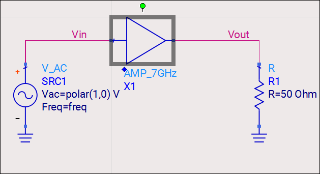
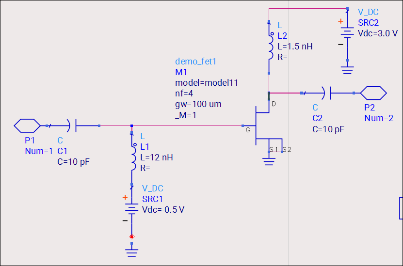
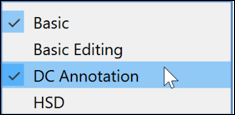
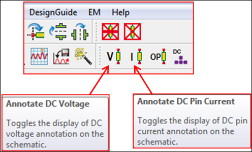
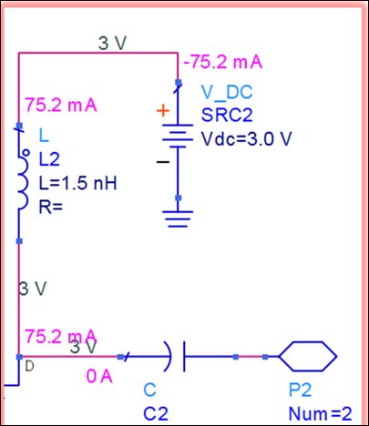
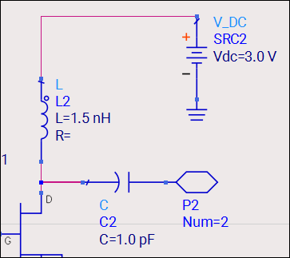
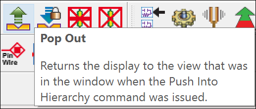

# Lab 3B - Module 5: DC annotation in schematic

**Learning Objectives:** In this module, you will complete the following tasks:

- Run the analysis
- Push into hierarchy edit
- Enable DC annotation
- The DC node values
- Clear the annotation
- Pop out

## Task 1: Run the analysis

1. Click on the simulate icon 

>**Warning:** Do not close the data display.

## Task 2: Push into hierarchy edit

   

1. Return to the schematic window

1. Select **AMP_7GHz** circuit.

1. Click on **Push Into Hierarchy Edit**

### AMP_7GHz subcircuit

   

## Task 3: Enable DC annotation

1. Right click the tool bar to enable the DC annotation first.

1. Click the **Annotate DC Voltage and Annotate DC Pin Current** toolbar icons.

## Task 4: The DC node values

You should see the DC bias values (voltage and current) at each node. The minus sign (-) for current is used only to indicate the direction (out or into a node).

   

## Task 5: Clear the annotation

1. Click on the Annotation buttons again.

The annotation should clear.

   

## Task 6: Pop out

1. Push back to the top level when done.

## You have successfully completed Lab 3B - Module 5.

Now, click on **Next >>** from the lower right corner to move on to the next page.

   
