# Lab 3B - Module 7: Variable equation and parameter sweep for simulation

**Learning Objectives:** In this module, you will complete the following tasks:

- Deactivate the DC simulation controller
- Use variable equation
- Parameter sweep setup
- Run the simulation
- Notice the changes

## Task 1: Deactivate the DC simulation controller

1. Click DC simulation controller

   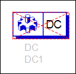

1. Click icon.

   

This is something that you can also do with components if you want them available but not used for a specific simulation.

## Task 2: Use variable equation

1. Insert a VAR into schematic.

   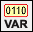

1. Change the name (left side of the equation) to: **L_val**.

1. Use your cursor directly on-screen or edit (double-click) the VAR

   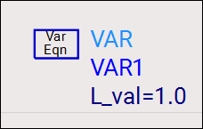

### **Push into subcircuit**

1. Push into the **AMP_7GHz** amplifier subcircuit

   

   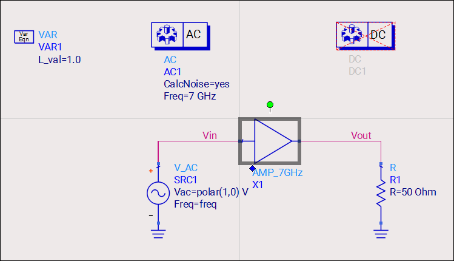

1. Change the drain inductor L2 from 1.5 nH to **L_val nH**.

   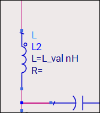

   >**Note:** Now, the inductor initial value comes from the variable and has a value of 1.0 nH. It is important to keep the units as nH. Otherwise, the value would be in Henrys, which are the default units for inductance.

1. Pop out to the top level schematic. 

   

## Task 3: Parameter sweep setup

To sweep a variable for AC analysis, you need a Parameter Sweep component, available in any simulation palette.

1. Choose **Simulation-AC** palette

   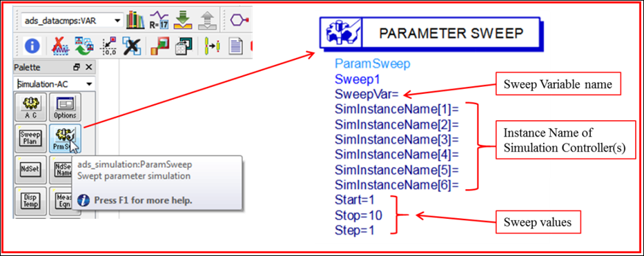

1. Insert a **ParamSweep** component.

   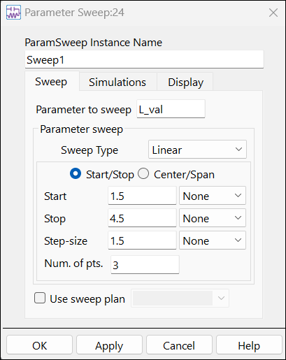

1. Double click the **Parameter Sweep** component.

1. Go to **Sweep tab**

1. Set **Parameter to sweep** = **L_val**

1. Set **Start** = **1.5,** **Stop** = **4.5,** **Step** = **1.5** increments

   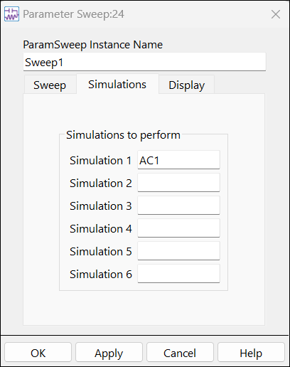

1. Go to the **Simulations tab**

1. Set **Simulation 1** = **AC1** (AC controller name)

1. Click **OK**.

1. It should look like this.

   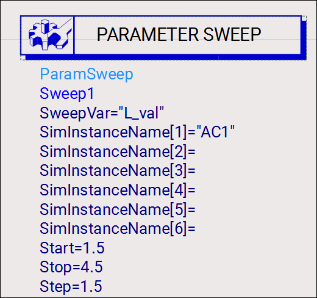

>**Note:** Notice that the quotes are automatically applied. The parameter sweep is now ready. If you typed in the names on screen, you would have to type quotes.

## Task 4: Run the simulation

1. Click **F7** or the icon 

   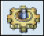.

## Task 5: Notice the changes

Your list now shows the swept values. Select the lists and stretch the corner to make them wider.

   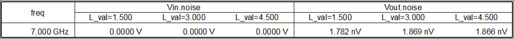

   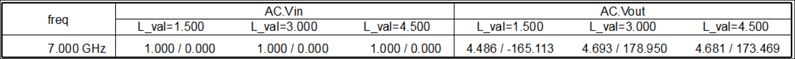

## You have successfully completed Lab 3B.

Now, click on **Next >>** from the lower right corner to move on to **Lab 4A**.

   
