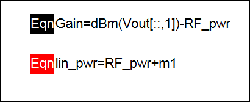
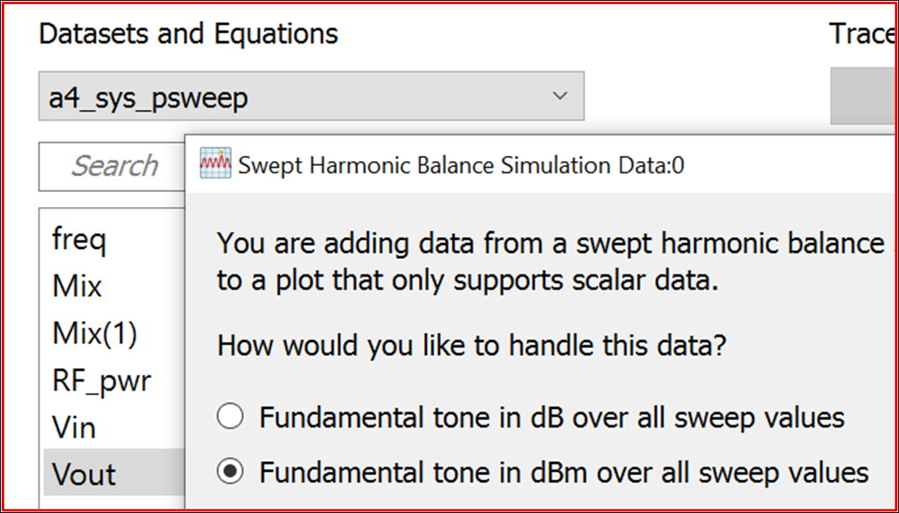
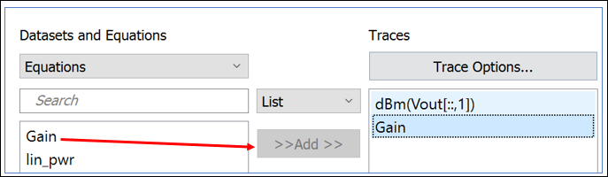
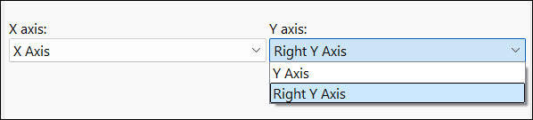
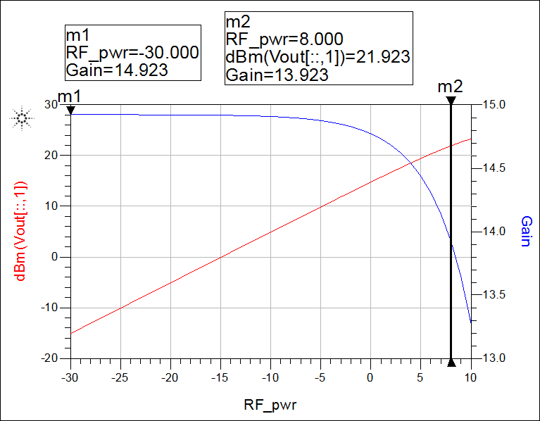
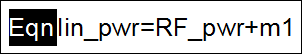
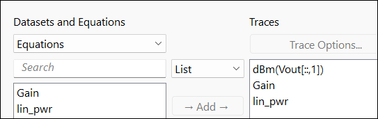
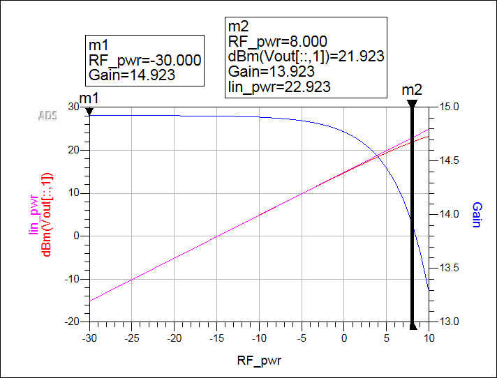

# Lab 4A - Module 5: Display the swept power data

**Learning Objectives:** In this module, you will complete the following tasks:

- Gain equation
- Add Vout to the plot
- Add Gain to the plot
- Examine the data display
- lin_pwr equation
- Add lin_pwr to the plot
- Examine the data display

## Task 1: Gain equation

The data display **a4_Sys_psweep** will open once the simulation completes.

   

Notice there is already an equation for **Gain** on the data display. This equation is only correct when the input impedance of the amplifier and of the load is exactly 50 Ohms.

## Task 2: Add Vout to the plot

   

1. Insert a rectangular plot. 

1. Double-click **Vout**.

1. Select **Fundamental Tone in dBm over all sweep values**.

1. Click OK

## Task 3: Add Gain to the plot

   

1. Change the dataset to **Equations**

1. Add **Gain**.

### Change the Y-axis to Right Y Axis

   

1. Double-click on **Gain** on the right side under Traces (opens Trace Options dialog).

1. Select the **Plot Axes** tab, change the Y-axis to **Right Y Axis**.

1. Click OK twice

## Task 4: Examine the data display

   

- Place a marker m1 

- Place a line marker m2  on the Gain plot.

- Make sure that both m1 and m2 are at the same locations as shown in the plot.

>**Note:** The output power begins to flatten out as the amplifier goes into compression. It is easier to see the Gain compression on this plot than the power compression due to the scales used.

## Task 5: lin_pwr equation

Notice there is an equation called **lin_pwr** defined on the data display.

   

>**Note:** This equation was red (invalid) until you added marker m1 because the value of m1 is used in the equation and while it was missing the equation could not be evaluated.

>**Note:** Linear power is calculated as the input power plus the linear gain. This is why m1 must be at a power level at which the system is in the quasi-linear area of the response.

## Task 6: Add lin_pwr to the plot

   

1. Add **lin_pwr** to the plot.

1. Click OK

## Task 7: Examine the data display

Observe that it is now easier to see how the output power starts to compress.

   

Save the data display.

## You have successfully completed Lab 4A - Module 5.

Now, click on **Next >>** from the lower right corner to move on to the next page.

   
