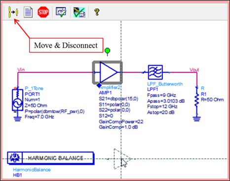
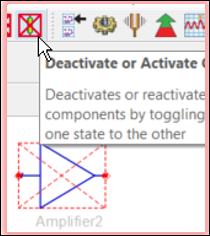
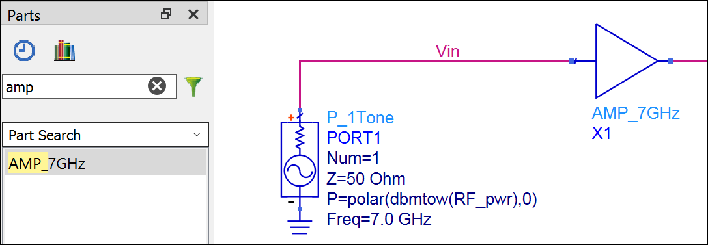
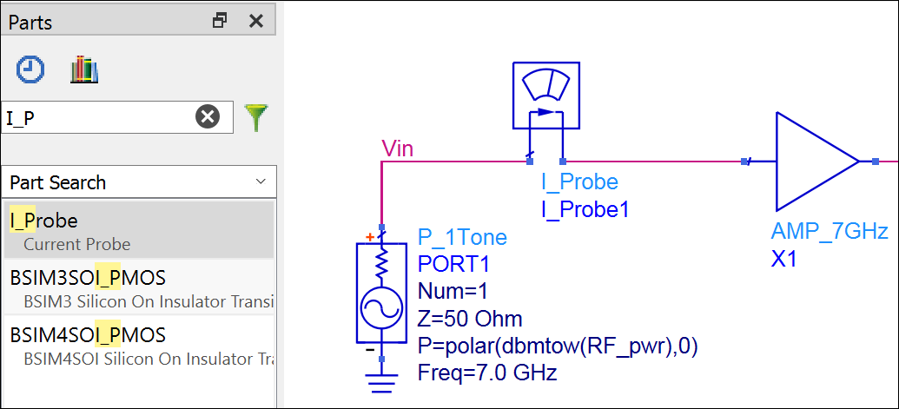
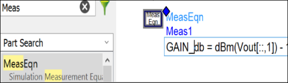
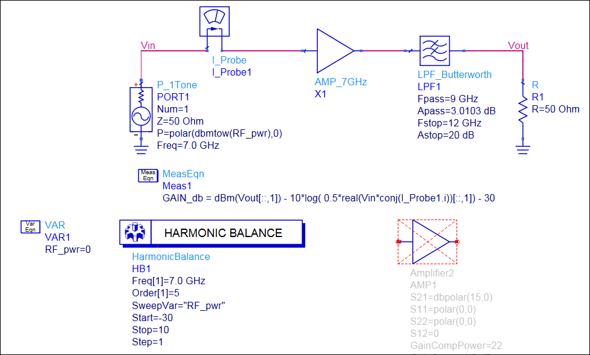
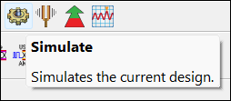
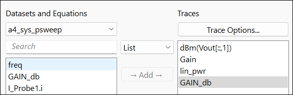
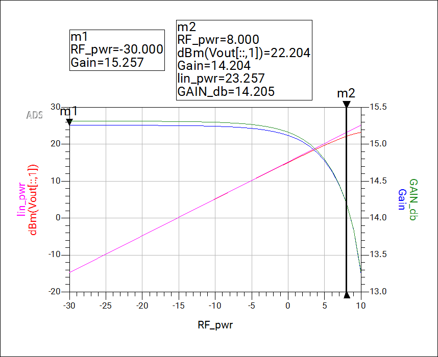
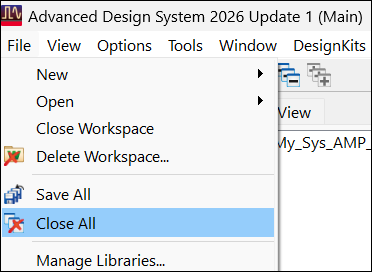

# Lab 4A - Module 6: HB simulation of PDK amplifier system

**Learning Objectives:** In this module, you will complete the following tasks:

- Move and disconnect amplifier

- Build amplifier system

- Run the simulation

- Add Gain_db to the plot

- Examine the data display

- Close All

## Task 1: Move and disconnect amplifier

1. In the schematic window, press and hold the **Ctrl** key and then left-click and drag the Amplifier2 symbol away from the circuit (same as the menu command **Edit > Move > Move & Disconnect**).

   

1. Then **Deactivate** amplifier. Now it will not be netlisted but is available for use later if needed.

   

## Task 2: Build amplifier system

1. In the Parts search field, type **amp_**

   

1. Insert **AMP_7GHz** where Amplifer2 was before.

   

1. Type **i_p,** insert an **I_Probe** symbol in front of the amplifier.

1. Select the small wire segment between the pins of the I_Probe and delete it.

1. To Add MeasEqn equation type **Meas,** insert a MeasEqn component.

   

1. Edit the MeasEqn to:

    ```
    GAIN_db = dBm(Vout[::,1]) - 10*log( 0.5*real(Vin*conj(I_Probe1.i))[::,1]) - 30
    ```

1. **Save** the design

   - The syntax [::,1] picks out the values of a computed quantity for all values of RFpwr but only at the fundamental frequency.

1. It should look like this

   

## Task 3: Run the simulation

**Run** the simulation.



## Task 4: Add Gain_db to the plot

1. Add **GAIN_db** to the plot

1. Choose the right y-axis under *Trace Options*.

   

## Task 5: Examine the data display

The gains are slightly different because the amplifier’s input match is not exactly 50 Ohms.

   

## Task 6: Close All

From the ADS Main window, use **File > Close All** and save your work.

   

## Now, click on **Next >>** from the lower right corner to move on to the Knowledge Check page.

   