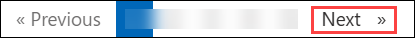

# ADS102: ADS Layout and PCB Design

### Estimated Duration: 630 Minutes

## Overview

This hands-on lab series is made up of 7 ADS102 labs, completed in sequence:

- **Lab 1A: Intro to ADS Architecture** (90 Minutes): This lab will introduce the ADS Open Access architecture, the concept of workspaces, libraries, cells, cell views, and technology files. It will also show you how preferences can be defined by users of libraries or design kits and how these are stored in ADS.

- **Lab 1B: Create Custom Layers** (60 Minutes): To create custom layers, one can either modify the existing default layers (so as to have some good pre-built choices of colors, patterns, etc.) or one can create a custom technology completely from scratch.

- **Lab 02: Layout Basics** (150 Minutes): This lab shows you how to draw shapes precisely and modify them using the many built-in ADS edit functions. The key to efficient generation of layouts is to understand snap modes and use shortcut keys for the most common commands.

- **Lab 3A: Interconnect Layout and Routing** (90 Minutes): This lab demonstrates how to use Process Design Kits (PDK’s) and Vendor Component Libraries (VCL’s) - as they are available from many vendors world-wide - using a demo design kit developed by Keysight EEsof. For SMD parts, they are usually called VCL’s and for IC foundary processes, they are called PDK’s, but the internal structure is similar.

- **Lab 3B: Automated Via Stitching and Plane Design** (60 Minutes): Execute multilayer routing using automatic via stitching, construct a ground plane with specified clearances, and connect the GND nodes to the capacitors.

- **Lab 4A: Schematic-Driven Layout for Double-Sided RF PCBs** (60 Minutes): In this lab, you will inspect the 2 sided RF board technology and place components from schematic to layout.

- **Lab 4B: RF Board Design Flow and PCB Layout** (120 Minutes): This lab shows a manual RF board design flow. You will create a layout for a low-noise amplifier. A PCB Design Kit will be used to place components on both sides of an FR4 substrate. Interconnects will be routed and ground planes will be cleared around them.

## Getting started with your lab

Welcome to your Keysight Advanced Design System (ADS) hands-on lab. This environment gives you a Windows 11 virtual machine with **Advanced Design System 2027** pre-installed, along with the lab workspaces you need to complete each module.

## Accessing Your Environment

Your virtual machine and this **Guide** are available within your web browser.

   

## Environment Details

1. To access the virtual machine over RDP, use the values on the **Environment** tab.

    - **VM DNS Name:** <inject key="VM DNS Name" enableCopy="true"/>
    - **Username:** <inject key="VM Username" enableCopy="true"/>
    - **Password:** <inject key="VM Password" enableCopy="true"/>

1. Your Deployment ID for this run is **<inject key="DeploymentID" enableCopy="false"/>**. Quote it if you contact support.

## Exploring Your Resources

To get a better understanding of your resources and credentials, navigate to the **Environment** tab.

   

## Utilizing the Split Window Feature

For convenience, you can open the guide in a separate window by selecting the **Split Window** button from the top right corner.

   

## Managing Your Virtual Machine

Feel free to **Start, Restart,** or **Stop** your virtual machine as needed from the **Resources** tab. Your experience is in your hands!

   

## Guide Zoom In/Zoom Out

To adjust the zoom level for the environment page, click the **A↕: 100%** icon located next to the timer in the environment.

   

## Lab Structure

| Lab | Module | Topic |
|-----|--------|-------|
| Lab 1A | Module 1 | Create a new workspace and library |
| Lab 1A | Module 2 | Standard ADS Layer definitions |
| Lab 1A | Module 3 | Library specific layer preferences |
| Lab 1A | Module 4 | Creating custom layer |
| Lab 1B | Module 1 | Create a new workspace and library |
| Lab 1B | Module 2 | Modify the existing default layers |
| Lab 1B | Module 3 | Create custom technology from scratch |
| Lab 1B | Module 4 | Draw shapes on your custom layers |
| Lab 02 | Module 1 | Create a new workspace, library and layout |
| Lab 02 | Module 2 | Basic layout skills: drawing, measure, snap |
| Lab 02 | Module 3 | Drag and move, select, copy using reference |
| Lab 02 | Module 4 | Join, Union |
| Lab 02 | Module 5 | Modify rectangle into trapezoid |
| Lab 02 | Module 6 | Step and repeat |
| Lab 02 | Module 7 | Union of multiple polygons |
| Lab 02 | Module 8 | Boolean operations, subcircuits, mirror |
| Lab 3A | Module 1 | Install the supplied design kit |
| Lab 3A | Module 2 | Examine technology files |
| Lab 3A | Module 3 | Basic routing and editing interconnects |
| Lab 3A | Module 4 | Non-orthogonal Interconnects |
| Lab 3A | Module 5 | Use of avoidance routing |
| Lab 3B | Module 1 | Install the supplied design kit |
| Lab 3B | Module 2 | Multilayer Routing using Automatic Via Stitching |
| Lab 3B | Module 3 | Connecting GND to capacitor |
| Lab 4A | Module 1 | Load the RF Board Flow workspace and PDK |
| Lab 4A | Module 2 | Inspect technology |
| Lab 4A | Module 3 | Manual placement of schematic components in layout |
| Lab 4B | Module 1 | Load the RF Board Flow workspace and PDK |
| Lab 4B | Module 2 | Automatic placement of wire-connected components |
| Lab 4B | Module 3 | Connect components with traces |
| Lab 4B | Module 4 | Create ground planes |

>**Note:** Complete the labs in the order listed, starting with Lab 1A. Within each lab, the modules are not independent, so complete them in order.

## Launch Advanced Design System

Click the shortcut icon for ADS on your screen, or use the Start > Programs command to find and start Advanced Design System.

   

## Support Contact

The CloudLabs support team is available 24/7 via email and live chat.

- Email Support: labs-support@spektrasystems.com
- Live Chat Support: https://support.cloudlabs.ai/isv

Now, click on **Next >>** from the lower right corner to move on to the next page to begin with Lab 1A, Module 1.

   

## Happy Learning !!
