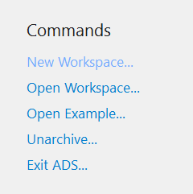
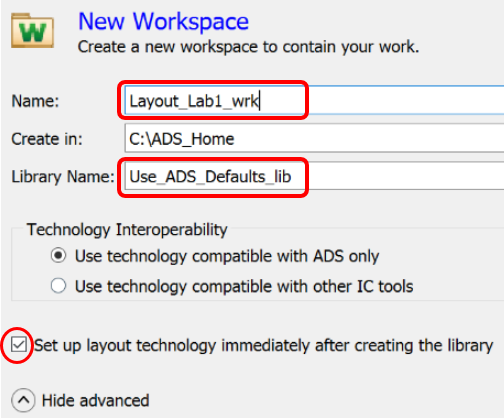
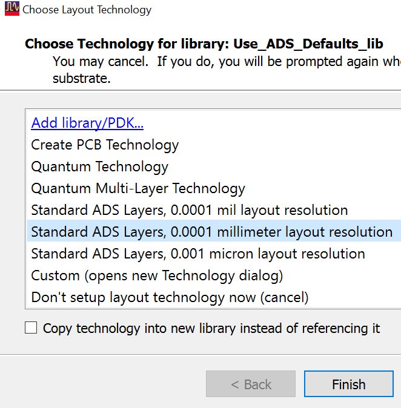

# Lab 1A - Module 1: Create a new workspace and library

**Learning Objectives:** In this module, you will complete the following tasks:

- Create a new workspace
- Choose technology for library

This module contains the following lessons:

## Task 1: Create a new workspace

1. Click New Workspace...

   

   

1. Set Name = **`Layout_Lab1_wrk`**

1. Create in C:\ADS_Home

1. Click Show advanced

1. Check the Set up layout technology… flag.

1. Set Library Name = **`Use_ADS_Defaults_lib`**

1. Click **Create Workspace**

## Task 2: Choose technology for library

   

1. Choose **Standard ADS Layers, 0.0001 millimeter layout resolution**.

1. Click **Finish.**

## You have successfully completed Lab 1A - Module 1.
