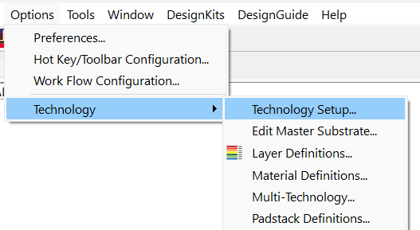
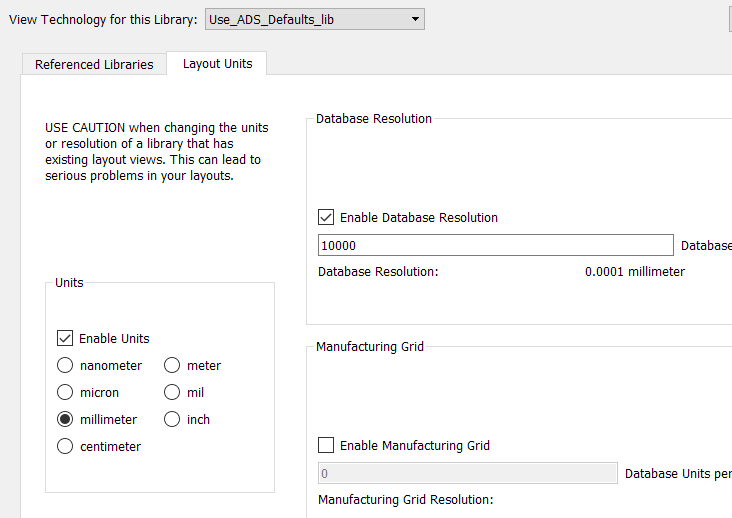
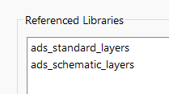
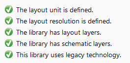
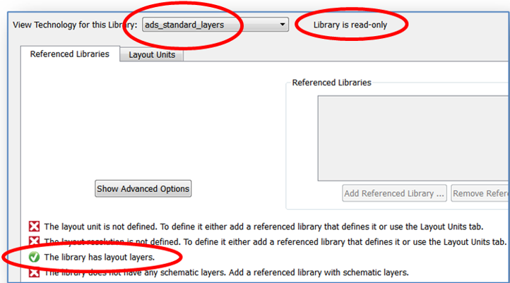
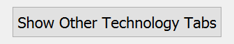
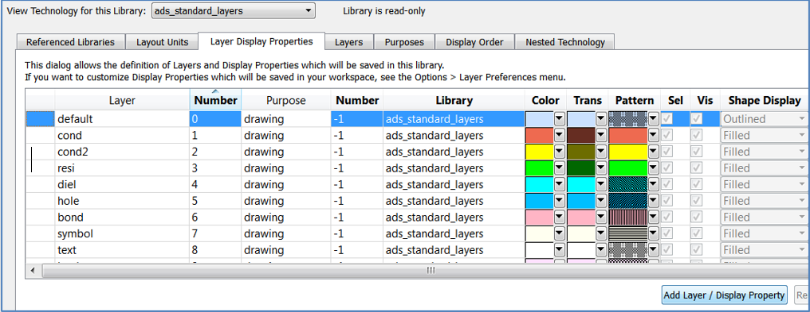

# Lab 1A - Module 2: Standard ADS Layer definitions

**Learning Objectives:** In this module, you will complete the following tasks:

- Inspect the technologies
- Use_ADS_Defaults_lib
- ADS Standard Layers

This module contains the following lessons:

## Task 1: Inspect the technologies

Use **Options > Technology > Technology Setup** to inspect the technologies associated with the libraries.

   

## Task 2: Use_ADS_Defaults_lib

   

The tab **Layout Units** shows us the units in which layouts in the selected library will be interpreted (xy-coordinates in layouts are stored only in integer database units). It also shows the resolution that will determine the smallest spacing between objects that can be created. When you change units or resolution, existing layouts in that library will be in a different size than the original. For example, a 1 mm long rectangle will become 1 mil long if you change units from mm to mil.It will become 10 mm long if you change resolution from 10000 to 1000, and so on. Therefore, choosing the units up front is very important.

1. **Click** on the **Referenced Libraries** tab.

Notice that the library **`Use_ADS_Defaults_lib`** references the layers from the built-in libraries **ads_standard_layers** and **ads_schematic_layers.**

>

Take a look at the status messages at the bottom left. Libraries do not necessarily have to have all check marks green depending on what they will be used for. Notice that there is also the option to work interoperable with other Open Access tools which is not necessary when working with ADS standalone.

   

## Task 3: ADS Standard Layers

1. Select the **ads_standard_layers** library.

It contains only layout layers, but no units, resolution nor schematic layers.

   

1. Click the button  at the top right.

Take a look at what the tabs **Layer Display Properties**, **Layers**, **Purposes** and **Display Order** contain.

   

For read-only libraries, you cannot edit anything inside those libraries.

For your own libraries, any referenced read-only library entries are also protected except the *Display Order* (saved as ASCII file *display.tech* inside the directory *Layout_Lab1_wrk\Use_ADS_Defaults_lib* ).

Later, you will see how to customize the display properties for the read-only layers, but at the workspace level.

**Cancel** the dialog box.

## You have successfully completed Lab 1A - Module 2.
