# Lab 1A - Module 3: Library specific layer preferences

**Learning Objectives:** In this module, you will complete the following tasks:

- Create layout
- Open layers window
- Draw rectangle
- Origin crosshair
- Grid display
- Coordinate readout
- Layer display properties
- *layerprf
- Reset all layers to default

This module contains the following lessons:

## Task 1: Create layout

   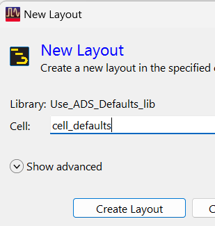

1. Using the  icon or **Window > New Layout**

1. Set Cell = **`cell_defaults`**

1. Click **Create Layout**

## Task 2: Open layers window

Execute **Options > Layer Preferences.** This opens a docking window.

   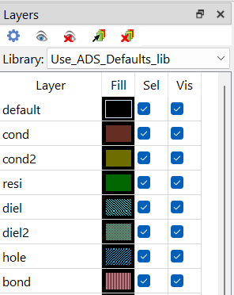

The command **View > Docking Windows** shows all that are available.

   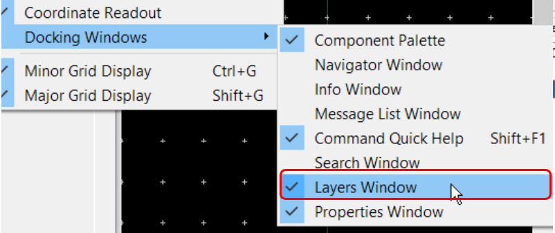

### Layers window

Docking windows can be detached from the main layout window by double-clicking on the top border. Dragging the top border on top of another docking window (color turns bluish) stacks them one behind the other.

   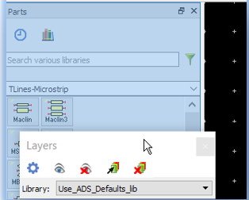

### Layers window

They can then be selected by tabs at the bottom.

   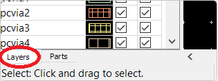

## Task 3: Draw rectangle

1. Click the **Insert Rectangle** icon on default insert layer **`cond`**. Tap the **ESC** key

   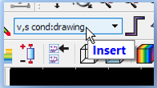

   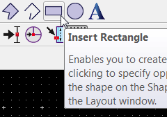

1. **Press** and **hold** the right mouse button in the layout window and move the mouse to **pan** the view.

   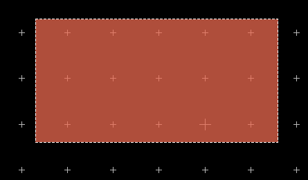

1. With a wheel mouse, **move the cursor to a point around which you want to zoom** and scroll in and out.

## Task 4: Origin crosshair

Toggle the Origin Crosshair off/on with **Shift+O**.

   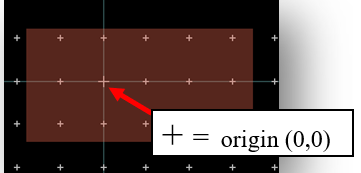

## Task 5: Grid display

Toggle the **major grid display** off/on with **Shift+G.**

   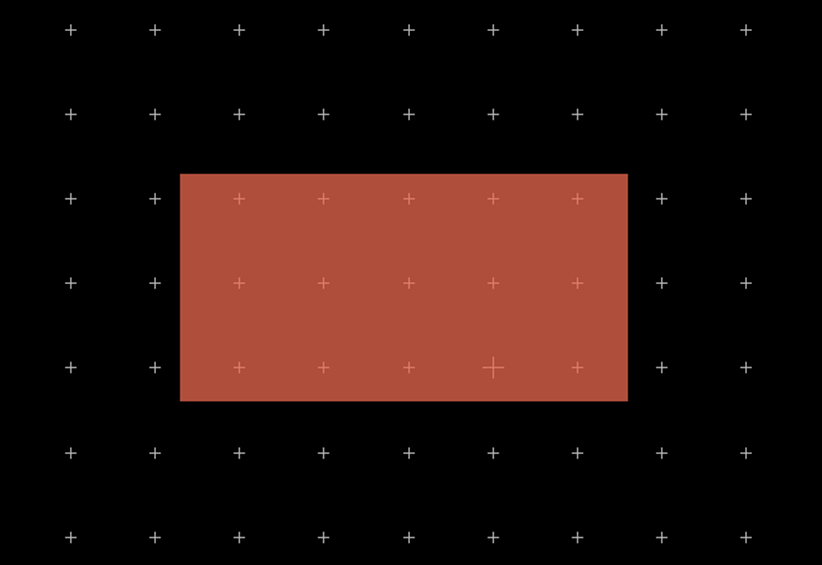

Toggle the **minor grid display** off/on with **Ctrl+G.**

   

## Task 6: Coordinate readout

Click the lower left vertex.

   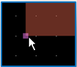

Check the coordinate readout at the bottom right of the window and compare with the values in the Properties window.

   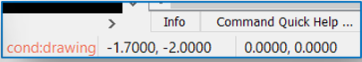

   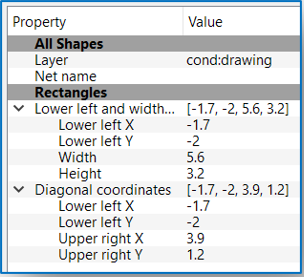

1. **Move** the mouse cursor to upper right vertex

   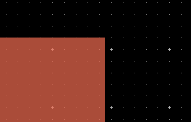

1. Check the absolute and relative readouts

   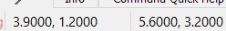

## Task 7: Layer display properties

Double-click on the fill field for the layer **`cond`**.

   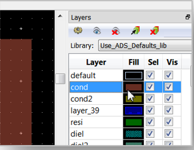

Lower the transparency to make it more opaque.

   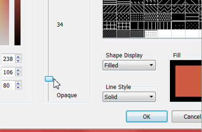

### Change the color and pattern

Change the **color** and **pattern** and notice the effect on the rectangle.

   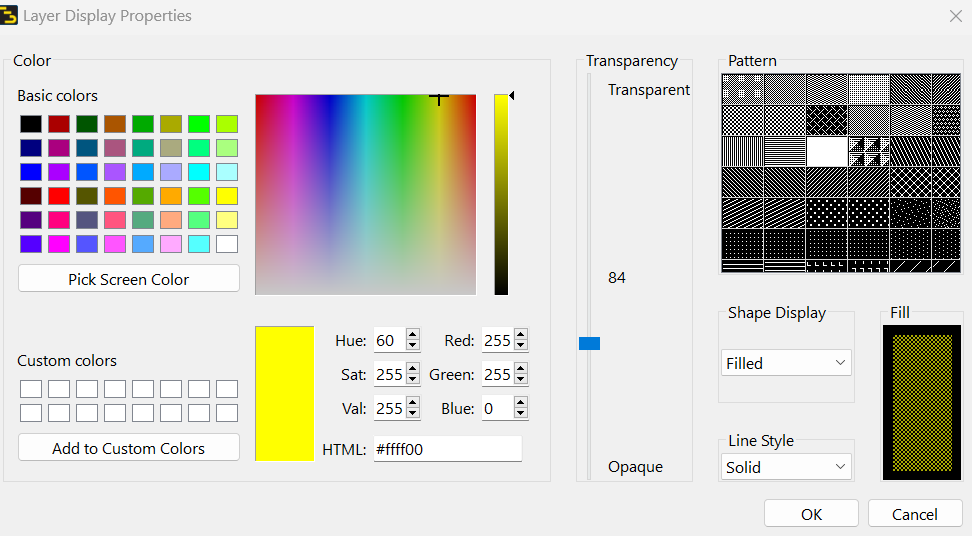

## Task 8: *layerprf

The layer properties you set using the *Layer Preferences* window are stored dynamically in a file with syntax **&lt;libName>.layerprf** inside the workspace folder C:\ADS_Home\Layout_Lab1_wrk. Here it is called *ads_standard_layers.layerprf* .

   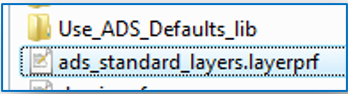

Every layout that you create in this workspace and whose library references the ADS library *ads_standard_layers* will use these custom properties.

If you want to use them in another workspace, you would need to copy the *layerprf file into it.

## Task 9: Reset all layers to default

In the **Layers** palette, select the gear icon. Click on **Reset All Layers to Default.** Click **Yes** to continue.

   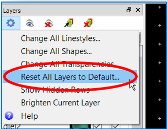

   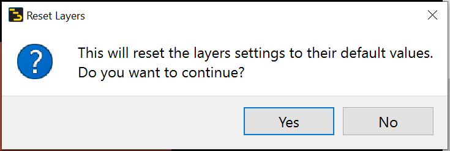

> **Note:** This deletes the * ***layerprf*** file in the file system.

## You have successfully completed Lab 1A - Module 3.
