# Lab 1A - Module 4: Creating custom layer

**Learning Objectives:** In this module, you will complete the following tasks:

- Add new layer
- Layer drawing order
- Brighten Current Layer
- Experiment with the order
- Sort layers by library

This module contains the following lessons:

## Task 1: Add new layer

   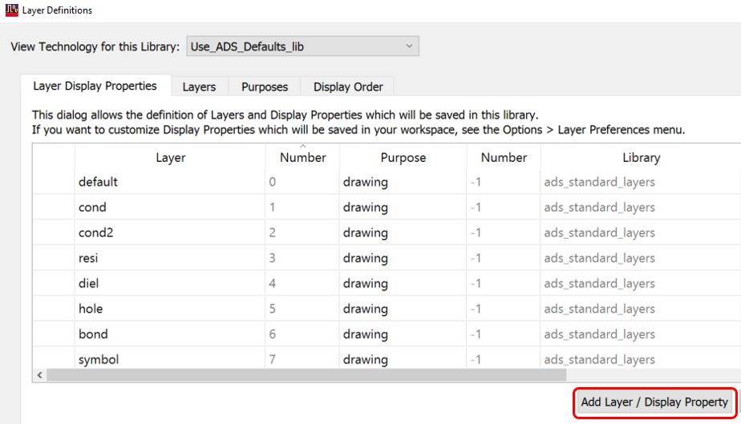

1. Use **Options > Technology > Layer Definitions**

1. Select **Layer Display Properties** tab

1. Click the button at the bottom **Add Layer / Display Property**

Dismiss any info dialogs after checking the flag “Don’t show this message again”.

   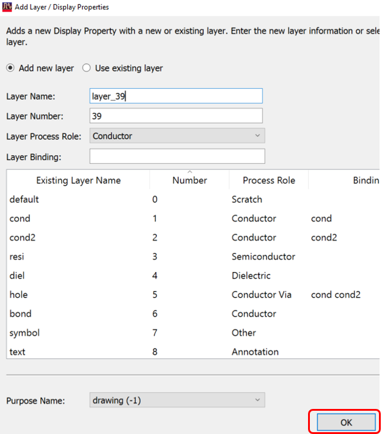

1. Click **OK**

### layer_39 has been created

   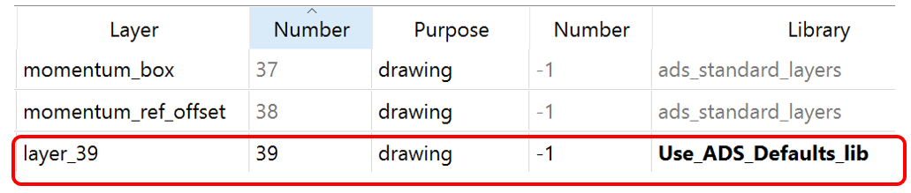

Note that library **Use_ADS_Defaults_lib** is being used.

The number the UI chooses by default is the first undefined layer number. It cannot be any number that is already defined.

### Select a color

   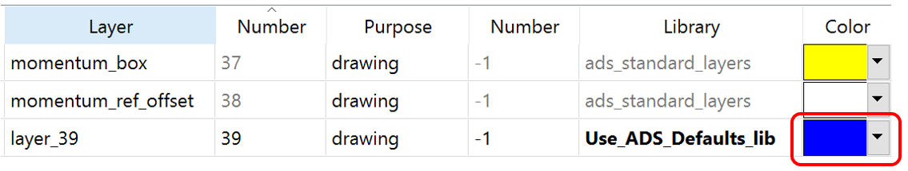

1. Select a color for **`layer_39`**

## Task 2: Layer drawing order

   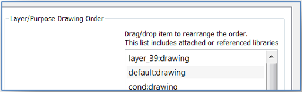

Go to the **Display Order** tab. Notice **`layer_39`** is 1st in the list. This means that shapes on that layer are drawn first followed by the other layers potentially drawing on top of the shapes on **`layer_39`**.

Click OK to close the dialog.

In the layout window, select **`layer_39`** as the insert layer.

   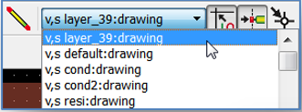

Draw another rectangle that partially overlaps the first one.

   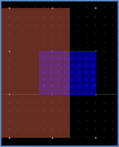

In Layers window, change the transparency to 0% for layers **`cond`** and **`layer_39`**. Change the **patterns** to be **solid.**

   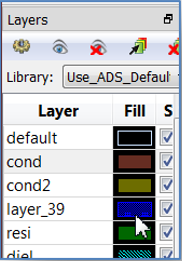

   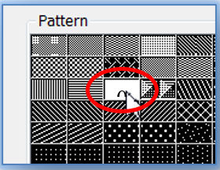

   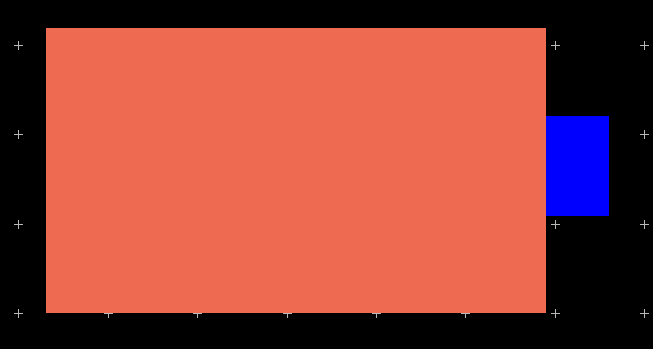

## Task 3: Brighten Current Layer

In the Layers window, select the gear icon and **turn on** the flag Brighten Current Layer.

   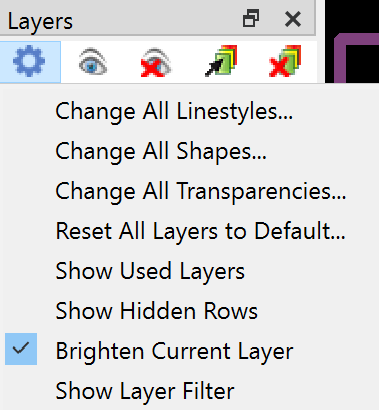

   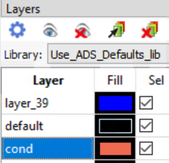

1. Click on **`cond`** to see the effect.

   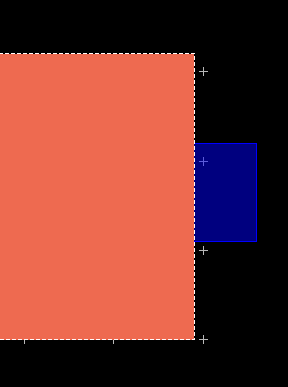

1. Click on **`layer_39`**to see the effect.

   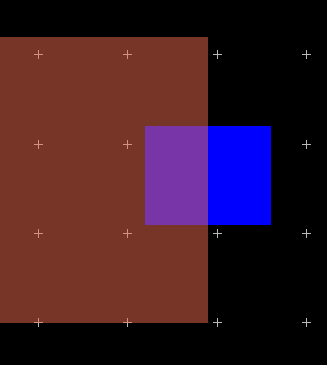

> **Note:** This flag overrides the transparency settings. Turn the flag **OFF**

## Task 4: Experiment with the order

1. Using **Options > Technology > Layer Definitions**

1. Select **Display Order** tab

1. Drag **`layer_39`** below **`cond`** in the list.

1. Click **Apply**

   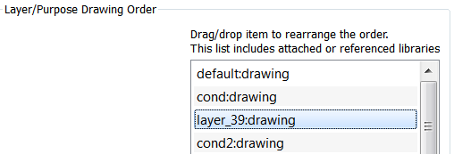

If your layout window is not covered by the Layer Definitions dialog, you can see the changes as soon as you click Apply.

   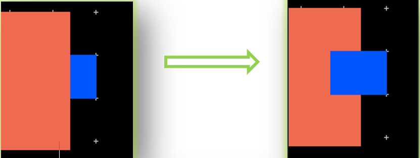

Try reversing the display order and see the changes.

   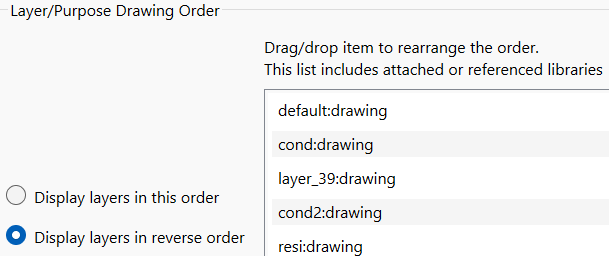

## Task 5: Sort layers by library

Under the **Layers** tab, click on the column name **Library** so `layer_39` is on top. Most column headings can be used for sorting.

   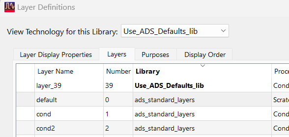

**Close** the *Layer Definitions* dialog and layout window.

## You have successfully completed Lab 1A.
