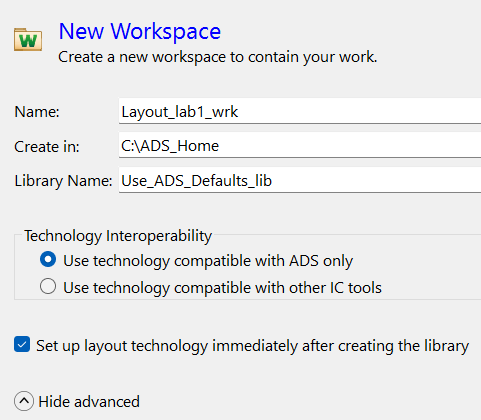
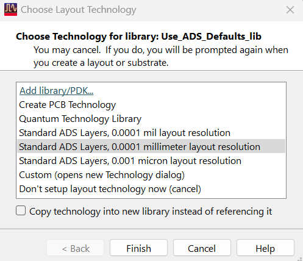

# Lab 1B - Module 1: Create a new workspace and library

**Learning Objectives:** In this module, you will complete the following tasks:

- Create a new workspace
- Choose technology for library

This module contains the following lessons:

## Task 1: Create a new workspace

   

1. Click **Create a New Workspace**  icon

1. Set **Name** = **Layout_Lab1_wrk**

1. Set **Create in** = C:\ADS_Home

1. **Check** Set up layout technology immediately after creating the library

1. Set **Library Name** = **Use_ADS_Defaults_lib**

1. Click **Create Workspace**

## Task 2: Choose technology for library

   

1. Choose **Standard ADS Layers, 0.0001 millimeter layout resolution**

1. Click **Finish**

## You have successfully completed Lab 1B - Module 1.
