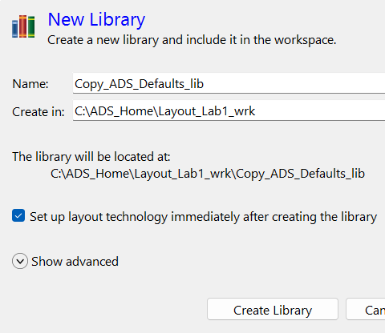
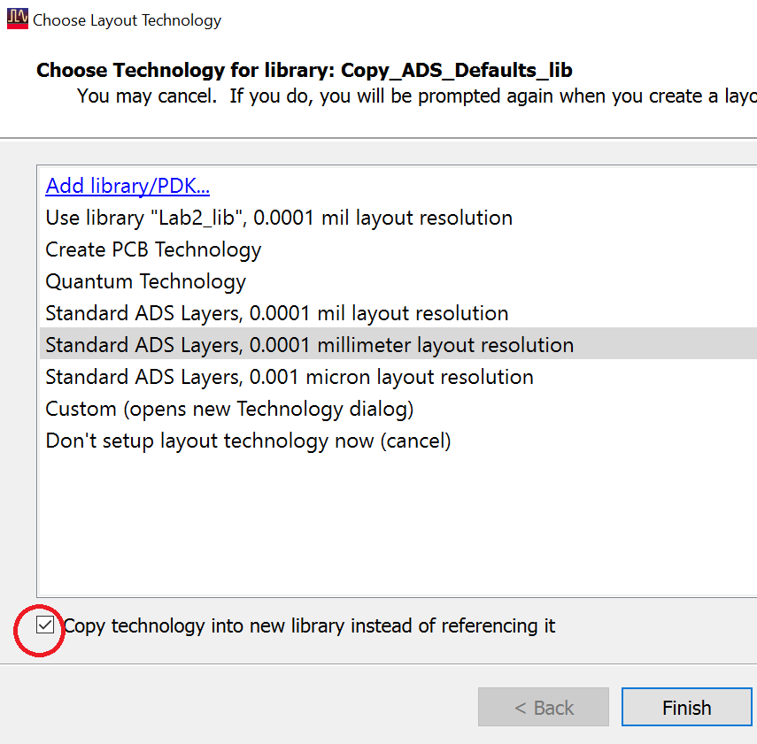
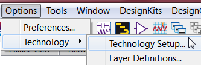
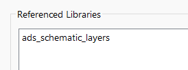
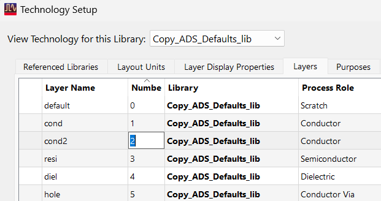
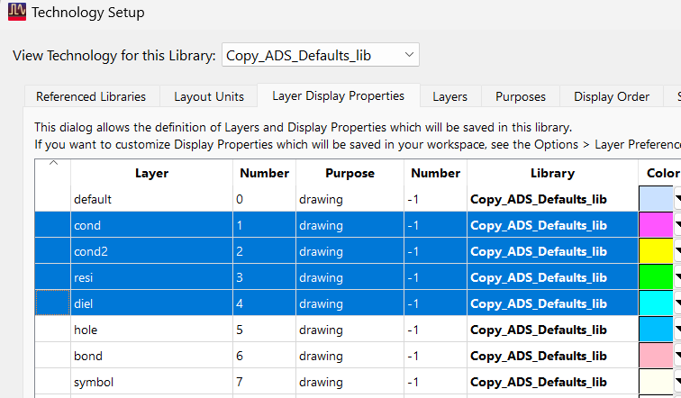

# Lab 1B - Module 2: Modify the existing default layers

**Learning Objectives:** In this module, you will complete the following tasks:

- Create new library
- Copy technology into new library
- Reference libraries
- Modify default layers
- Remove multiple layers

This module contains the following lessons:

## Task 1: Create new library

   

1. In the ADS Main window, use the **File → New → Library** command

1. Set **Name** = `**Copy_ADS_Defaults_lib**`

1. Click on **Create Library**

## Task 2: Copy technology into new library

   

1. Choose **Standard ADS Layers, 0.0001 millimeter layout resolution**

1. Check **Copy technology into new library....**.

1. Click **Finish**

## Task 3: Reference libraries

1. In ADS Main Window, use **Options > Technology > Technology Setup**

   

Under **Referenced Libraries** tab, only **ads_schematic_layers** is used.

   

## Task 4: Modify default layers

Click Show Other Technologies Tabs

   

Go to Layers tab, you can now edit the names, numbers, colors, etc. as you wish.

   

## Task 5: Remove multiple layers

If you want to select multiple layers to remove them, you must click a column that is not editable such as the blank column before the *Layer Name* column or the *Library* column entries. Then use the standard Shift/Ctrl key methods to select ranges or non-sequential layers.

   

Click **Cancel** to exit the Technology Setup dialog.

## You have successfully completed Lab 1B - Module 2.
