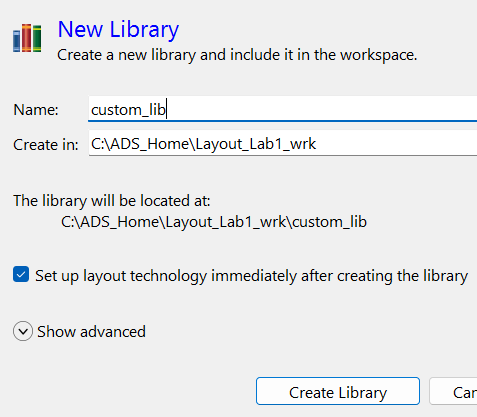
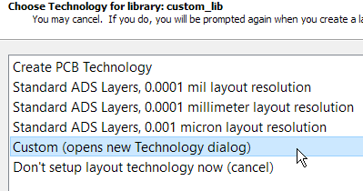
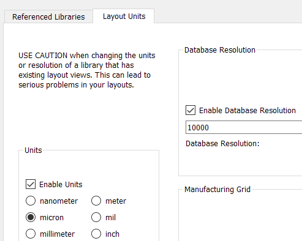
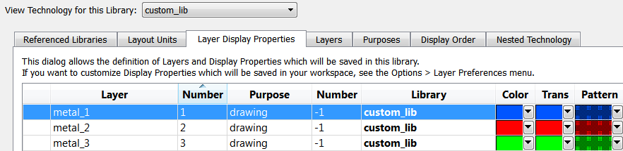
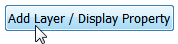

# Lab 1B - Module 3: Create custom technology from scratch

**Learning Objectives:** In this module, you will complete the following tasks:

- Create new library
- Open new technology dialog
- Technology setup
- Create 3 new layers

This module contains the following lessons:

## Task 1: Create new library

   

1. In the ADS Main window, use the **File → New → Library** command

1. Set **Name** = **`custom_lib`**

1. Click on **Create Library**

## Task 2: Open new technology dialog

   

1. Select **Custom (opens new Technology dialog)**

1. Click **Finish**

## Task 3: Technology setup

   

1. In **Layout Units** tab, check **Enable Units**

1. Select **micron** units

1. Check **Enable Database Resolution**

## Task 4: Create 3 new layers

   

1. Go to **Layer Display Properties** tab

1. Click on button to create 3 new layers **metal_1**, **metal_2** and **metal_3**

1. Edit new layers with some colors, transparencies and patterns of your choice.

1. Sort them in the same order in the Display Order tab.

## You have successfully completed Lab 1B - Module 3.
