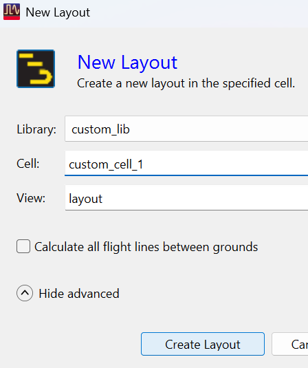
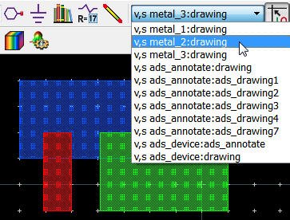

# Lab 1B - Module 4: Draw shapes on your custom layers

**Learning Objectives:** In this module, you will complete the following tasks:

- Create layout
- Draw shapes on your custom layers

This module contains the following lessons:

## Task 1: Create layout

   

1. Set **Library** = **`custom_lib`**

1. Set **Cell** = **`custom_cell_1`**

1. Click **Create Layout**

## Task 2: Draw shapes on your custom layers

Draw some simple shapes on your custom layers.

   

## You have successfully completed Lab 1B.
