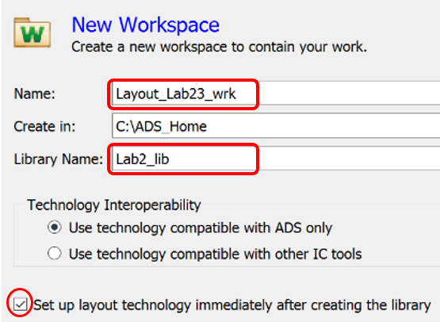
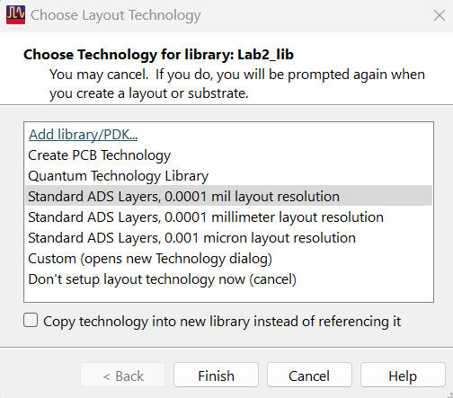
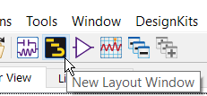
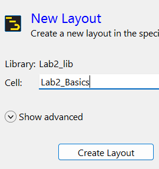
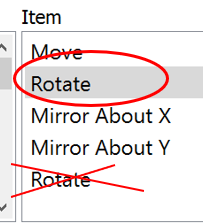
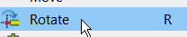

# Lab 02 - Module 1: Create a new workspace, library and layout

**Learning Objectives:** In this module, you will complete the following tasks:

- Create a new workspace and library
- Create layout
- Hot key configuration

This module contains the following lessons:

## Task 1: Create a new workspace and library

   

1. Set Name = **`Layout_Labs23_wrk`**

1. Create in C:\ADS_Home

1. Click *Show advanced*

1. Set Library Name = **`Lab2_lib`**

1. Click **Create Workspace**

### Choose technology for library

   

1. Choose **Standard ADS Layers, 0.0001 mil layout resolution**.

1. Click **Finish**

## Task 2: Create layout

Click the **New Layout** icon to create a layout view in a new cell called **`Lab2_Basics`** in the library **`Lab2_lib`**.

   

   

## Task 3: Hot key configuration

Use **Options > Hot Key/Toolbar Configuration** to define the following shortcuts:

| **Category** | **Item** | **Hot Key** |
|---|---|---|
| File\ | Save As | F2 |
| Edit\ | Rotate | R |
| Edit\Move\ | Move Edge | Shift+E |
| Edit\Move\ | Move Relative | Shift+R |
| Insert\ | Coordinate Entry | K |
| Options\ | Preferences | P |
| Options\ | Layer Preferences | L |

1. Click **Assign** after each definition and overwrite existing definitions where necessary.

> **Important:** For the function key F2, simply type the string “F2” (without quotes and do not press the actual function key).

> **Important:** Make sure to pick the first Rotate item.

   

1. Click **Close** when done.

1. Check the commands in the corresponding pull-down menus to make sure you defined them all correctly.

   

## You have successfully completed Lab 02 - Module 1.
