# Lab 02 - Module 2: Basic layout skills: drawing, measure, snap

**Learning Objectives:** In this module, you will complete the following tasks:

- Insert circles
- Measure
- Open layer window
- Create polygon
- Insert rectangle
- Create polyline
- Create polygon with arc
- Insert circle

This module contains the following lessons:

## Task 1: Insert circles

1. Click the **Circle** icon

   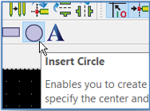

1. Insert a circle at the origin (0,0) with a radius of 10.

   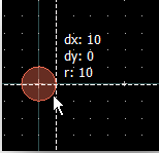

1. Insert a 2nd **10 mil** circle at **(200,0)**.

   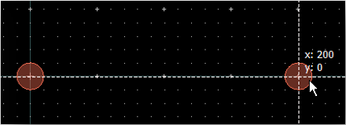

> **Important:** Keep the *Insert > Circle* command active.

Note as you move the mouse that the default snap distance is 5 mil (2 snap points per visible grid dot).

1. Type “**K**” (Insert > Coordinate Entry)

1. Enter an **Absolute** coordinate of (**100, 182**) click **Apply** (**not** OK)

1. Enter a **Relative** coordinate of (**14.3, 0**) for the radius and click **OK**.

1. Click 

   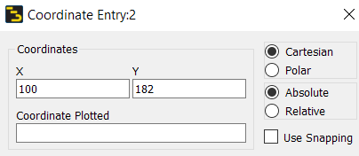

   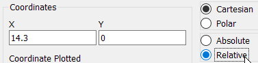

Type “**f**” ( *View > View All* ) to see the entire layout in full view.

   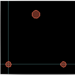

## Task 2: Measure

1. Type **`Ctrl` + `M`** (Insert > Measure)

1. Click the origin (0,0).

1. Move the cursor to the center of the top circle.

Notice how the crosshairs only snap to grid points.

   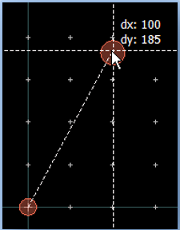

### Activate snaps

1. Activate **Circle Center** snap, **Vertex** snap and **Midpoint** snap.

   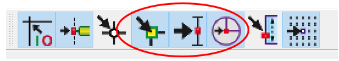

These snap points, plus the Pin snap which is on by default, are the most important and can generally be left on. One should never deactivate snapping.

### Repeat the same measurement

1. Type **Ctrl+M** (Insert > Measure)

1. Click the origin (0,0).

1. Move the cursor to the top circle center again until it snaps to it (you have to get quite close).

1. Press the **spacebar**.

   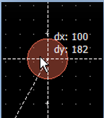

   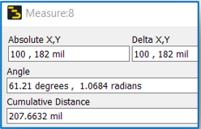

Using the spacebar, you do not have to use the *Clear* button for multiple point-to-point measurements.

### Update snap distance

1. Type “**p**” ( *Options > Preferences* ), select **Grid/Snap** tab

1. Change the **Snap Distance** to **40** screen pixels.

1. Click OK

   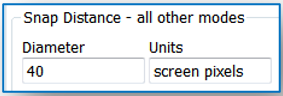

### Repeat the same measurement

The Measure command should still be active.

1. Click the origin (0,0).

1. Move the cursor to the top circle center again until it snaps to it.

> **Note:** Notice that the crosshairs now snap to the circle centers from a further distance than before.

1. Press the **spacebar**.

### Cumulative measurement

1. Make a cumulative measurement from the centers of circle 1 to 2 to 3.

1. Click 

   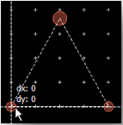

   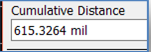

## Task 3: Open layer window

Type "**L**" (Options > Layers Preferences)

   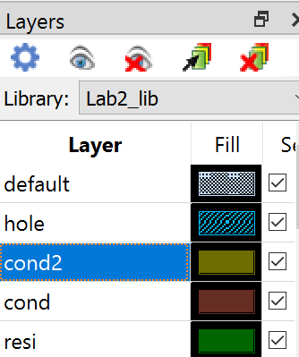

## Task 4: Create polygon

1. Make **`cond2`** the insert layer.

   

1. Click the **Create Polygon** icon. 

   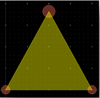

1. Click at **(0,0),** then click the center of the top circle.

1. Move the cursor to the bottom right.

1. *Instead of clicking* , press the **spacebar**.

> **Note:** The last two vertex points of the polygon are added automatically.

1. Press the **Esc** key or (click )

## Task 5: Insert rectangle

1. Change insert layer to `hole`.

   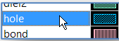

1. Click the **Insert Rectangle** icon. 

1. Click at **(0,0),** then move down diagonally to **(200,-200).**

1. Press **spacebar** to close.

   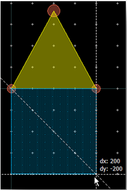

> **Important:** You could also left-click but then if you move the mouse slightly, you may get the wrong point.

## Task 6: Create polyline

1. Make **`resi`** the insert layer.

   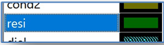

1. Click the **Create Polyline** icon. 

1. Click the midpoint of the rectangle’s bottom edge **(100,-200).**

   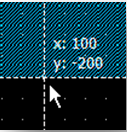

1. Click at (**dx: 0, dy: -40**), then (**dx: 30, dy: 0)**, and then at **(dx: 0, dy: 40).**

| 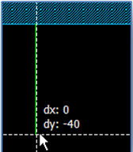 | 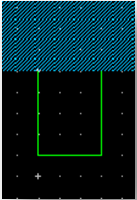 |
|---|---|

1. Finishing with **spacebar**.

## Task 7: Create polygon with arc

1. Use the menu **Insert > Arc (start, end, circumference)**

1. Insert an arc from the **left, top vertex** of the polyline to the **right, top vertex**

1. Move the mouse up dx -15, dy 15 and click.

   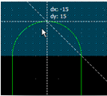

1. Select the arc, and the polyline object (use Shift+click)

1. Right-click on the outline

1. Use **Modify > Join** to create a polygon with an arc.

   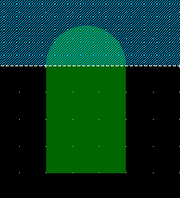

## Task 8: Insert circle

1. Change to layer **`leads`**.

   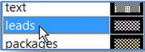

1. Insert a circle  at **(130,-220).**

   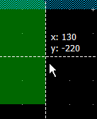

1. Press “**K**” to enter a relative **x=2** value for the radius.

   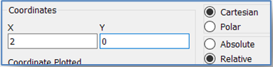

   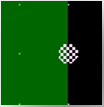

1. Click 

1. **Save** the layout

## You have successfully completed Lab 02 - Module 2.
