# Lab 02 - Module 3: Drag and move, select, copy using reference

**Learning Objectives:** In this module, you will complete the following tasks:

- Drag and move
- Move relative
- Create group
- Stretch
- Turn on outlined display
- Select mode for polygons
- Ungroup
- Copy using reference
- Scale

This module contains the following lessons:

## Task 1: Drag and move

1. Press “**f**” to see the full view of the layout.

1. **Press** the left mouse button and without releasing it, **drag** one of the shapes a small distance.

   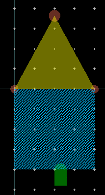

Notice that after a very short distance, the selected objects begin to move. This can be a source of errors if one selects objects too quickly while the mouse is still moving.

### Enable drag and move

1. Press “**p**”, select the **Entry/Edit** tab

1. Change the *Drag and Move Threshold* to **50** screen pixels.

1. Click **OK**.

   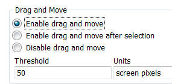

> **Note:** Drag an object slowly and notice how far you have to move the cursor before the object actually begins to move. If you release the mouse before the shape jumps, nothing is moved.

   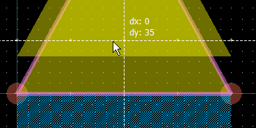

Undo the moves when done (**`Ctrl` + `Z`**). Unselect objects by clicking in the background of the layout window.

### Disable drag and move

1. Press **“p”**, select the **Entry/Edit** tab

1. Turn on **Disable drag and move**. Click **OK**.

   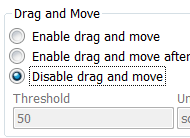

> **Note:** Now you cannot move objects using the mouse.

### Enable drag and move after selection

You can also try the **Enable drag and move after selection** command where you first need to select an object before you can drag it.

   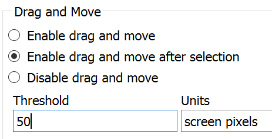

### Enable drag and move

When done experimenting, turn on **Enable drag and move** and set the **Threshold** to **12** screen pixels which is a better default for high resolution displays.

   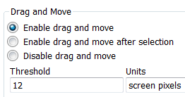

## Task 2: Move relative

1. Select the small circle on layer **`leads`**

1. Type **`Shift` + `R`** (Edit > Move > Move Relative)

1. Set **Delta X = -4.** OK.

   

   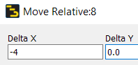

## Task 3: Create group

1. Select the circle and the **`resi`** polygon, right-click **Create Group**

1. Give it the name **Door**.

1. Click **OK**

   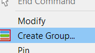

   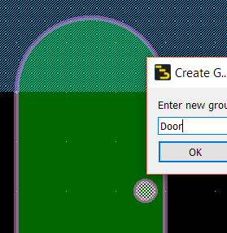

## Task 4: Move relative

1. Click the group **Door.**

1. Type **`Shift` + `R`**

1. Move it by **Delta Y = 47**

   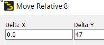

   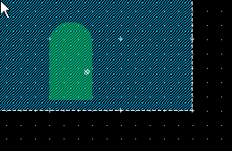

## Task 5: Stretch

1. Select the large rectangle on layer **`hole`**

1. Using the midpoint stretch handles, drag the left and right inwards by **15 mil**.

You can also use “**K**” and type the relative offset after clicking the stretch handle.

   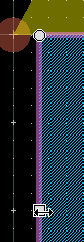

   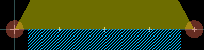

## Task 6: Turn on outlined display

   

   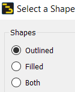

1. In the Layers window, click the tooth wheel

1. Choose **Change All Shapes**

1. Click **OK**

When you click inside the objects, they are no longer selected. If you get close to the edge, then you can select them.

   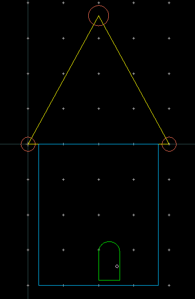

## Task 7: Select mode for polygons

1. Click **“p”**, and on the **Select** tab

1. Change the **Pick Box** to **40** pixels.

1. Click OK

   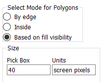

Move the mouse close to the outlines. The select activates with the cursor 4 times further away from the edge than before.

   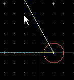

1. Click **“p”**, and on the **Select** tab.

1. Set **Select Mode** = **Inside**.

1. Set **Pick Box** = **15** screen pixels.

1. Click OK

   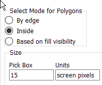

> **Note:** Now you can select objects by clicking inside even if they are in outline mode.

## Task 8: Ungroup

1. Right-click inside the group *Door* and choose **Ungroup**.

   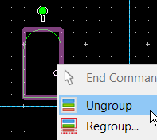

## Task 9: Copy using reference

1. Select the polygon on layer **`resi`** .

1. Type “**C**” (Copy Using Reference).

1. Click the bottom left vertex.

   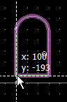

1. Type “**K**” and enter relative coordinates of **(-50,100)**. OK

   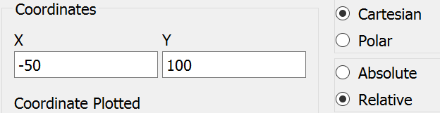

### Change layer

1. Select the new polygon, change its layer to **`bond`** in the *Properties* window.

   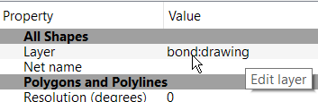

   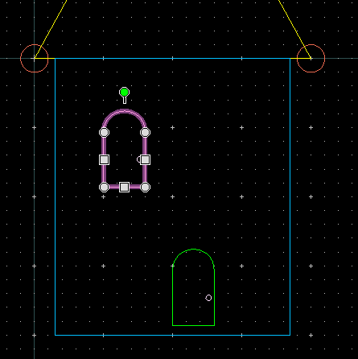

1. Type “**C**”

1. Click the bottom left vertex

   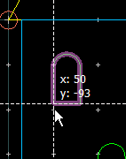

1. Type “**K**” and define a relative offset of **(70,0)**. **OK**

   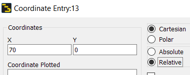

   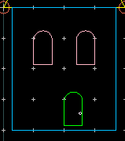

## Task 10: Scale

1. Select the **`resi`** polygon at the bottom.

1. **Edit > Scale/Oversize > Scale**.

1. Type scale factors of **1.3** for X and Y. Click **OK.**

   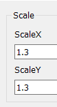

1. Click on the bottom right vertex.

| 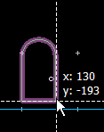 | 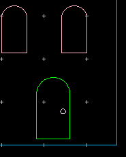 |
|---|---|

## Task 11: Move relative

1. Click the small **`leads`** circle. Edit its radius to 3 in the *Properties* window.

   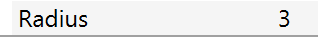

1. Use **`Shift` + `R`**

1. Move it **(-4,12)** up and to the left.

   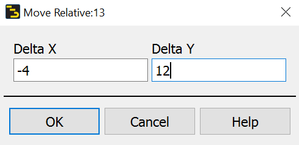

**Save** the layout.

## You have successfully completed Lab 02 - Module 3.
