# Lab 02 - Module 4: Join, Union

**Learning Objectives:** In this module, you will complete the following tasks:

- Insert construction line
- Intersection snap
- Join
- Union

This module contains the following lessons:

## Task 1: Insert construction line

1. Turn on **Options > 90 Degree Entry.**

   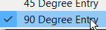

1. **Insert > Construction Line**

1. Click on the top circle center, then move the mouse to the right and click again to place a horizontal line.

   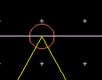

If you zoom out, you see the line has no end.

## Task 2: Intersection snap

1. Right-click on the triangle, choose **Modify > Explode**.

   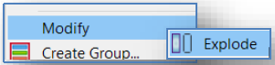

> **Note:** The polygon is converted into 3 polyline segments.

1. Turn on **Intersection Snap**.

   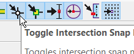

1. Select the left polyline segment

1. Click on the top vertex stretch handle

1. Move it to the left intersection of the circle with the construction line.

|  | 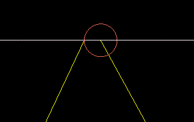 |
|---|---|

1. Repeat with the right polyline segment to move it to the right intersection.

   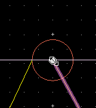

1. **Delete** the construction line.

## Task 3: Join

1. Change the insert layer to **`cond2`**.

   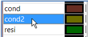

1. Draw a connecting polyline segment between the two endpoints you just moved.

   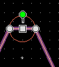

1. **Select > Select All on Layer**, choose **`cond2`**, **OK**.

   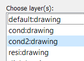

   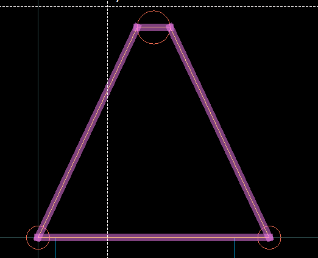

1. Right-click on one of the selected segments and choose **Modify > Join**.

> **Note:** You should now be able to select the new polygon by clicking inside it.

## Task 4: Union

1. Select the top circle, change its layer to **`cond2`** in the Properties window.

   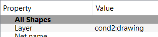

   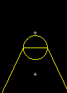

1. Select both circle and polygon on **`cond2`**

1. Execute **Edit > Merge > Union.**

   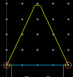

## You have successfully completed Lab 02 - Module 4.
