# Lab 02 - Module 5: Modify rectangle into trapezoid

**Learning Objectives:** In this module, you will complete the following tasks:

- Stretch
- Maintain adjacent angles
- Insert a rectangle
- Strecth
- Move using reference
- Move relative

This module contains the following lessons:

- Stretch

- Using Maintain adjacent angles during move

- Modify rectangle into trapezoid

- Copy using reference

- Step and repeat

- Move relative

## Task 1: Stretch

1. Select the rectangle on **`hole`**, click “**c**”

1. Snap to the left edge midpoint, and then snap to the right edge midpoint.

   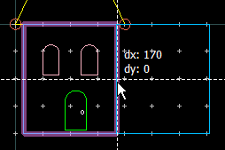

1. Stretch the right edge of the new rectangle **70 mil**.

   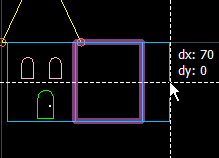

## Task 2: Maintain adjacent angles

1. Area select the 2 vertex points on the right. Try to drag them up.

   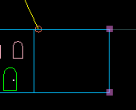

> **Note:** They will only move left or right.

1. Type “**p**”, select **Entry/Edit** tab

1. Turn **off** the *Maintain adjacent angles* flag.

1. Drag the vertex points up **100 mil**.

   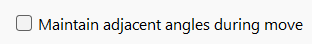

   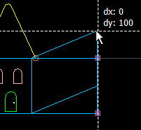

> **Note:** The rectangle has been converted into a polygon. Select the new shape and check the ***Info*** docking window (right-click on a toolbar).

   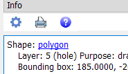

## Task 3: Insert a rectangle

Insert a rectangle on the **`bond`** layer as shown using the top-left and bottom-right vertex points of the existing bond layer polygon on the right.

   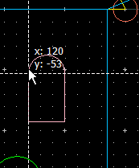

   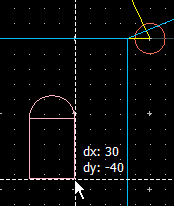

## Task 4: Strecth

Stretch the top edge up by 10 mil.

   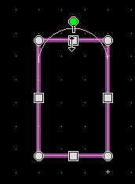

## Task 5: Move using reference

   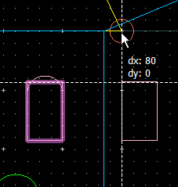

1. Type “**m**” (Edit > Move > Move Using Reference)

1. Click **top, left vertex**

1. Type “**x**” to constrain the move along the x-axis.

1. Click circle center at the top right.

## Task 6: Move relative

| 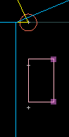 | 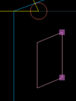 |
|---|---|

1. Type “**p**”, in the **Select** tab, turn on **Based on fill visibility**.

1. Area select the two vertex points on the right.

1. Type **Shift+R**

1. Move them up **12.5 mil**.

   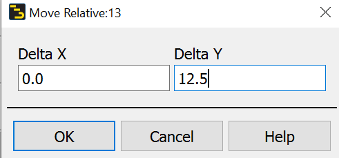

## You have successfully completed Lab 02 - Module 5.
